# Introduction

## What is this course about?

- **Data structure**: a way to organize data in memory so that some operations are fast.
- **Algorithm**: a precise sequence of steps that solves a problem.
- The two go together: the structure decides which algorithms are possible, and how fast they are.

## Why does it matter?

Find one name in a list of 1,000,000 names:

| method | comparisons (worst case) |
|---|---|
| check every name | 1,000,000 |
| sorted list, binary search | 20 |

- Same computer, same language — a different algorithm.
- With 1,000,000,000 names: 1,000,000,000 vs **30**.

## How we measure

- Not seconds: they depend on the computer, the language, other programs...
- We count **steps** (comparisons, assignments, loop iterations) as a function of the input size `n`.
- We ask: how does the number of steps **grow** when `n` grows?
- Worst case, best case, average case.
- Memory: how much **extra** memory, beyond the input itself?

## Course topics

- Math tools: powers, logarithms, sums, recurrences, induction
- Searching: linear search, binary search
- Sorting: insertion sort, merge sort, quicksort, heap sort
- Asymptotic notation: $O$, $\Omega$, $\Theta$
- Heaps and priority queues, quickselect
- Linked lists, stacks and queues (linked list, circular buffer)
- Binary search trees
- Hash tables

## Python

- Example code and exercises will be in Python.
- Python already has lists, `sorted`, `dict`, `set`, `bisect`, `heapq`...
- We implement the algorithms ourselves to understand **how** they work and **what they cost**.
- Then we know which built-in tool to choose, and why.

# Powers and logarithms

## Powers

$$
a^n = \underbrace{a \cdot a \cdots a}_{n \text{ times}}
\qquad 2^3 = 8 \qquad 10^6 = 1{,}000{,}000
$$

$$
a^m \cdot a^n = a^{m+n} \qquad \frac{a^m}{a^n} = a^{m-n} \qquad (a^m)^n = a^{m \cdot n}
$$

. . .

The rules decide what non-natural powers mean:

- $a^0 \cdot a^n = a^{0+n} = a^n \;\Rightarrow\; a^0 = 1$
- $a^{-n} \cdot a^n = a^0 = 1 \;\Rightarrow\; a^{-n} = \dfrac{1}{a^n}$
- $a^{1/2} \cdot a^{1/2} = a^1 \;\Rightarrow\; a^{1/2} = \sqrt{a}$

## Powers of 2

| $k$ | $2^k$ | about |
|---|---|---|
| 8 | 256 | |
| 10 | 1,024 | $10^3$ (thousand) |
| 20 | 1,048,576 | $10^6$ (million) |
| 30 | 1,073,741,824 | $10^9$ (billion) |
| 64 | 18,446,744,073,709,551,616 | $16 \cdot 10^{18}$ |

$2^{10} \approx 10^3$ is a useful approximation in this course.

$2^{64} = 2^{4} \cdot (2^{10})^6 \approx 16 \cdot (10^3)^6 = 16 \cdot 10^{18}$

## Logarithms

$\log_b x$ :\
**to what power do we raise $b$ to get $x$?**

$$
\log_b x = y \iff b^y = x
$$

- $\log_2 8 = 3$ because $2^3 = 8$
- $\log_2 1024 = 10$, $\log_2 1 = 0$, $\log_2 2 = 1$
- $\log_{10} 1{,}000{,}000 = 6$
- $\log_2 1{,}000{,}000 \approx 20$

In this course, $\log n$ without a base means $\log_2 n$.

## Logarithm rules

From the power rules:

$$
\log_b (x \cdot y) = \log_b x + \log_b y
$$

Proof:

Define: $m=\log_b x$, and $n=\log_b y$.

$\Rightarrow x = b^m$, $y = b^n$.

$\Rightarrow x \cdot y = b^m \cdot b^n = b^{m+n}$

$\Rightarrow\log_b(x \cdot y) = m + n$.

$\blacksquare$


## Logarithm rules (contd.)

$$
\log_b \frac{x}{y} = \log_b x - \log_b y
\qquad
\log_b x^k = k \cdot \log_b x
$$

Example: $\log_2 (1000 \cdot 1000) = \log_2 1000 + \log_2 1000 \approx 10 + 10 = 20$

## Change of base

$$
\log_b x = \frac{\log_a x}{\log_a b}
$$

- $\log_8 1024 = \dfrac{\log_2 1024}{\log_2 8} = \dfrac{10}{3} = 3.33...$
- $\dfrac{\log_2 n}{\log_{10} n} = \log_2 10 \approx 3.32$ — for **every** $n$.

All logarithms differ only by a constant factor.
That is why we often do not care about the base.

## How many times can we halve $n$?

$n \to n/2 \to n/4 \to \dots \to 1$

After $k$ halvings we have $n / 2^k$. We stop when $n / 2^k = 1$, that is $2^k = n$:

$$
k = \log_2 n
$$

| $n$ | 1,000 | 1,000,000 | 1,000,000,000 |
|---|---|---|---|
| halvings | ~10 | ~20 | ~30 |

The same for any constant fraction: dividing by 3, or keeping $3/4$ each time — still about $\log n$ steps (with a different base).

## In Python

```python
import math

math.log2(1024)         # 10.0
math.log2(1_000_000)    # 19.931568569324174
math.log(1024, 8)       # 3.3333333333333335
math.log10(1_000_000)   # 6.0
2 ** 64                 # 18446744073709551616  (Python ints have no size limit)
```

## Exercises

Exercises 1–3 in the exercises file.

# Sums

## Arithmetic series

$$
1 + 2 + 3 + \dots + n = \sum_{i=1}^{n} i = \frac{n(n+1)}{2}
$$

Pair the first with the last:

```text
  1 +   2 +   3 + ... + 100
100 +  99 +  98 + ... +   1
---------------------------
101 + 101 + 101 + ... + 101   = 100 · 101 = 2 × (the sum)
```

So $1 + \dots + 100 = \dfrac{100 \cdot 101}{2} = 5050$.

For large $n$: about $\dfrac{n^2}{2}$.

## Where it appears: nested loops

```python
count = 0
for i in range(n):
    for j in range(i):
        count += 1
```

- Inner loop runs $0, 1, 2, \dots, n-1$ times.
- Total: $0 + 1 + \dots + (n-1) = \dfrac{n(n-1)}{2}$
- $n = 1000$: 499,500 — about half of $n^2$.

See `code/count_steps.py`.

## Geometric series

$$
1 + 2 + 4 + \dots + 2^k = \sum_{i=0}^{k} 2^i = 2^{k+1} - 1
$$

In binary: `1 + 10 + 100 + 1000 = 1111`, and `1111 + 1 = 10000`.

## Proof by induction

Claim: $\sum_{i=0}^{k} 2^i = 2^{k+1} - 1$ for every $k \ge 0$.

- **Base**: $k = 0$: $2^0 = 1 = 2^1 - 1$. ✓
- **Step**: assume it holds for $k$. Then

$$
\sum_{i=0}^{k+1} 2^i = \underbrace{\sum_{i=0}^{k} 2^i}_{2^{k+1} - 1} + 2^{k+1} = 2 \cdot 2^{k+1} - 1 = 2^{k+2} - 1
$$

which is the claim for $k + 1$. ✓

## Geometric series: any ratio

In general, for $q \ne 1$:

$$
\sum_{i=0}^{k} q^i = \frac{q^{k+1} - 1}{q - 1}
$$

- $q = 2$: $\dfrac{2^{k+1} - 1}{1}$
- $q = \frac{1}{2}$: $1 + \frac12 + \frac14 + \dots < 2$ — always.

## Exercises

Exercises 4–5 in the exercises file.

# Searching

## Linear search

```python
def linear_search(a, target):
    for i in range(len(a)):
        if a[i] == target:
            return i
    return None
```

- Works on **any** list, sorted or not.
- Best case: 1 comparison. Worst case (last, or not found): $n$.
- Average (target is in the list, every position equally likely): about $n/2$.
- Python's `target in a` and `a.index(target)` are linear searches too.

## Lists of records

Often the items are records, and we search by one field:

```python
scientists = [("Curie", "Marie", 1898),
              ("Darwin", "Charles", 1859),
              ("Lovelace", "Ada", 1843),
              ("Newton", "Isaac", 1687)]
```

In this example we use a Python tuple as a record.

If we want to search for a scientist with the first name `"Isaac"`, the previous function will not work.

`linear_search(scientists, "Isaac")` returns `None`.

💡 Why?

## Searching by a field (1)

If we want to search by a specific field, we first need to define a function that gets a record and returns the field we search by:

```python
def last_name(s):
    return s[0]

def first_name(s):
    return s[1]

last_name(scientists[0])    # 'Curie'
first_name(scientists[3])   # 'Isaac'
```

## Searching by a field (2)

Then we add an additional parameter to `linear_search`, which is the "field" function.

The standard name for such a function is `key`.

```python
def linear_search(a, target, key):
    for i in range(len(a)):
        if key(a[i]) == target:
            return i
    return None

linear_search(scientists, "Newton", last_name)   # 3
linear_search(scientists, "Ada", first_name)     # 2
linear_search(scientists, "Curie", first_name)   # None
```

- `linear_search` does not know which field it compares: `key` decides.

## Python functions are values

In Python a function is a value, like a number or a string: it can be assigned to a variable and passed to another function.

```python
f = last_name                     # no parentheses: f is the same function
f(scientists[0])                  # 'Curie'

print(last_name)                  # <function last_name at 0x...>
print(last_name(scientists[0]))   # Curie
```

- `last_name` (no parentheses) is a reference to the function; it does not call it.
- `last_name(s)` calls it.

## Lambda: a function without a name

A short function can be written in one expression:

```python
def year(s):
    return s[2]

year = lambda s: s[2]       # the same function
```

- In `lambda s: s[2]`, the parameter is `s` and the value returned is `s[2]` (no `return`).
- Usually written directly in the call, without a name:

```python
linear_search(scientists, 1843, lambda s: s[2])     # 2
```

## A default key

```python
def linear_search(a, target, key=lambda x: x):
    for i in range(len(a)):
        if key(a[i]) == target:
            return i
    return None

linear_search([7, 3, 9], 9)                          # 2
linear_search(scientists, 1843, key=lambda s: s[2])  # 2
```

- The default `key` is the identity function: it returns the item itself.
- Python's `sorted`, `min` and `max` have the same `key` parameter.

## Binary search: the idea

The list is **sorted**. Look at the middle item:

- equal to the target: found;
- target is smaller: continue in the left half only;
- target is larger: continue in the right half only.

Each step throws away half of the candidates.

Like searching a word in a printed dictionary, or a guessing game: "I'm thinking of a number between 1 and 1000" — 10 questions are enough.

## Binary search: an example

Search for 41:

{width=100%}

## Binary search: the code

```python
def binary_search(a, target):
    lo = 0           # first index that may still hold target
    hi = len(a)      # one past the last index that may still hold target
    while lo < hi:
        mid = (lo + hi) // 2
        if a[mid] == target:
            return mid
        if target < a[mid]:
            hi = mid         # target can only be left of mid
        else:
            lo = mid + 1     # target can only be right of mid
    return None
```

- The candidates are always `a[lo:hi]` (`hi` not included).
- `lo == hi`: no candidates left — not found.
- Easy to get wrong: `hi = mid` vs `hi = mid - 1`, `lo < hi` vs `lo <= hi`. Keep **one** convention.

## Binary search: how many steps?

- Each step: candidates go from $m$ to at most $m/2$.
- At most $\lfloor \log_2 n \rfloor + 1$ steps.

| $n$ | linear (worst) | binary (worst) |
|---|---|---|
| 10 | 10 | 4 |
| 100 | 100 | 7 |
| 1,000 | 1,000 | 10 |
| 1,000,000 | 1,000,000 | 20 |

- The price: the list must be sorted (sorting is the next topic).
- Worth it when we search the same list many times.

See `code/search.py`.

## In Python: `bisect`

```python
import bisect

a = [1, 3, 3, 3, 7]
bisect.bisect_left(a, 3)    # 1  first index where 3 could be inserted
bisect.bisect_right(a, 3)   # 4  last index where 3 could be inserted
bisect.bisect_left(a, 4)    # 4  4 is not in a: this is where it would go
```

- Binary search that returns a **position**, not "found / not found".
- Found? Check `i < len(a) and a[i] == target`.
- Also has a `key` parameter (Python 3.10+).

## Timing

1,000,000 sorted numbers, average time of one search:

| method | time |
|---|---|
| `t in numbers` (list, linear) | tens of milliseconds |
| `bisect` (binary search) | ~2 microseconds |
| `t in as_set` (set) | ~0.2 microseconds |

- Binary search is ~10,000 times faster than linear here.
- `set` is even faster — it is a **hash table** (end of the course).

See `code/search_timing.py` (exact times depend on the computer).

## Exercises

Exercises 6–9 in the exercises file.

# Sorting

## Sorting in Python

```python
grades = [("Dana", 90), ("Noa", 85), ("Tamar", 90),
          ("Rivka", 85), ("Lea", 95)]

sorted(grades, key=lambda g: g[1])
# [('Noa', 85), ('Rivka', 85), ('Dana', 90), ('Tamar', 90), ('Lea', 95)]

sorted(grades, key=lambda g: g[1], reverse=True)
# [('Lea', 95), ('Dana', 90), ('Tamar', 90), ('Noa', 85), ('Rivka', 85)]
```

- `sorted(a)` returns a **new** sorted list; `a.sort()` sorts `a` **in place** (and returns `None`).
- Both take `key` and `reverse`.
- Two keys: `key=lambda g: (-g[1], g[0])` — by grade descending, then by name.

## Stability

A sort is **stable** if items with equal keys keep their original order.

```python
grades = [("Dana", 90), ("Noa", 85), ("Tamar", 90),
          ("Rivka", 85), ("Lea", 95)]
sorted(grades, key=lambda g: g[1])
# [('Noa', 85), ('Rivka', 85), ('Dana', 90), ('Tamar', 90), ('Lea', 95)]
```

- Noa before Rivka, Dana before Tamar — as in the input.
- Python's `sorted` is always stable.
- Why it matters: sort by name, then (stably) by grade → sorted by grade, and by name within each grade.

## Insertion sort: the idea

Like sorting cards in your hand:

- The left part of the list is already sorted (at first: one item).
- Take the next item, and move it left until the item before it is not larger.
- Larger items shift one place to the right to make room.
- Repeat until the sorted part is the whole list.

## Insertion sort: step i = 1

::: {.r-stack}
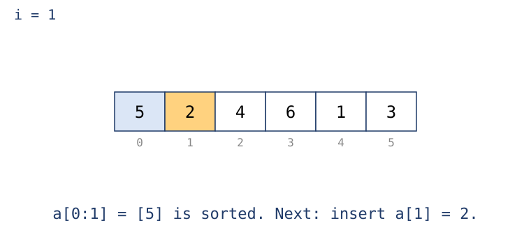{width=100%}

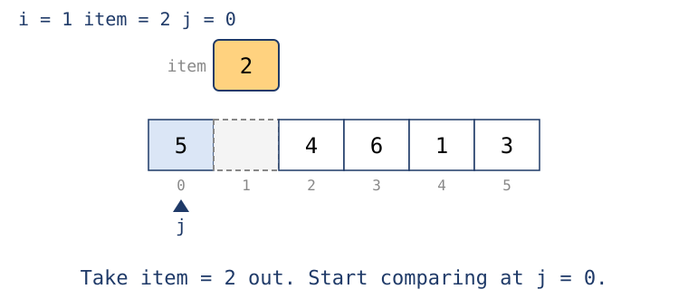{.fragment width=100%}

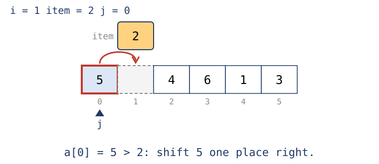{.fragment width=100%}

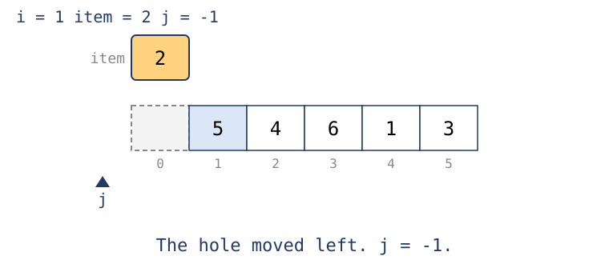{.fragment width=100%}

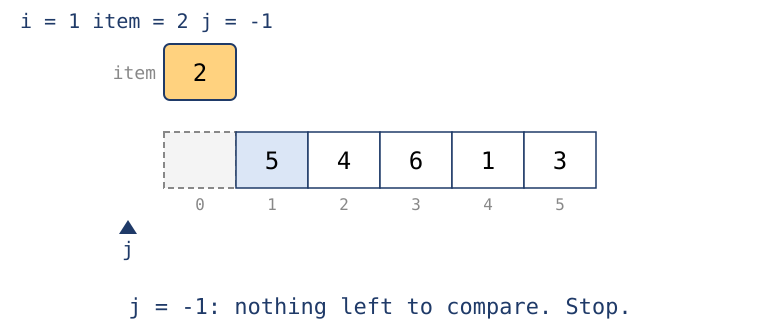{.fragment width=100%}

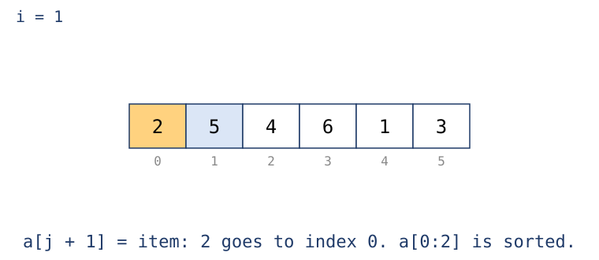{.fragment width=100%}
:::

## Insertion sort: step i = 2

::: {.r-stack}
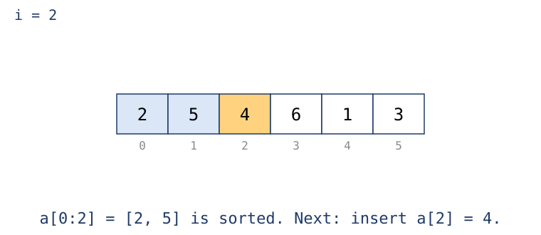{width=100%}

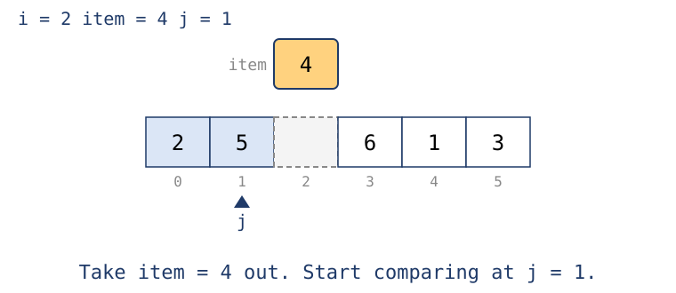{.fragment width=100%}

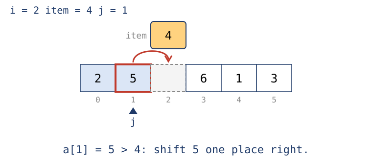{.fragment width=100%}

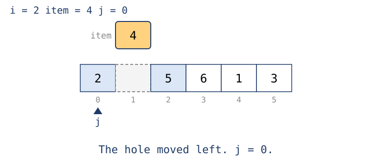{.fragment width=100%}

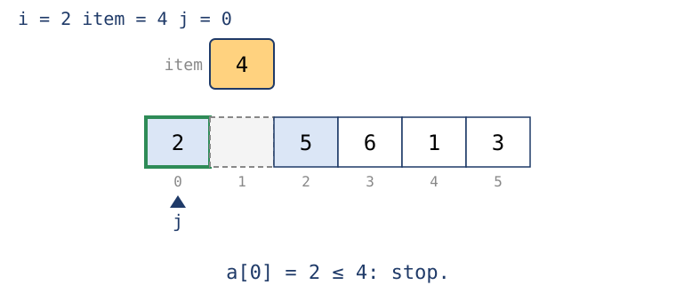{.fragment width=100%}

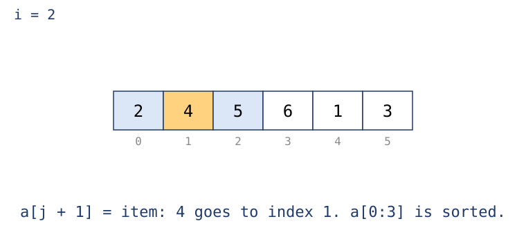{.fragment width=100%}
:::

## Insertion sort: step i = 3

::: {.r-stack}
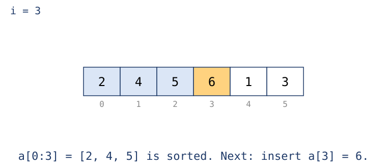{width=100%}

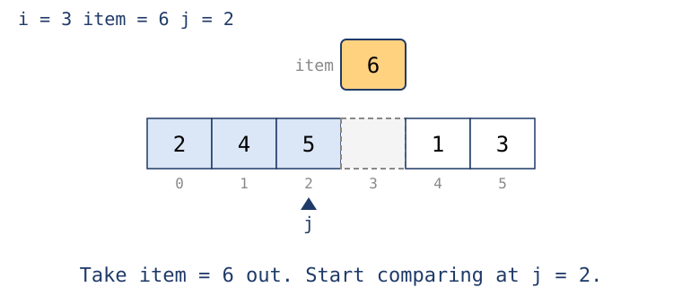{.fragment width=100%}

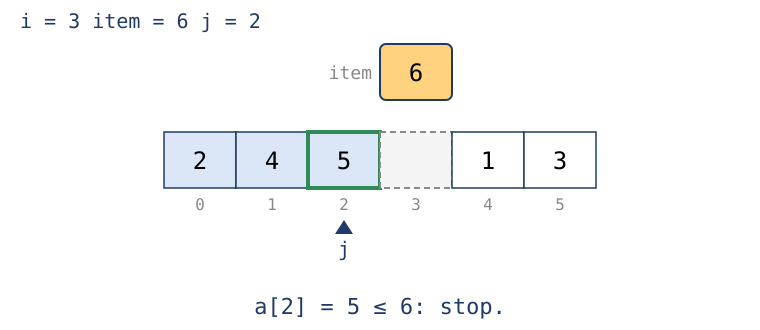{.fragment width=100%}

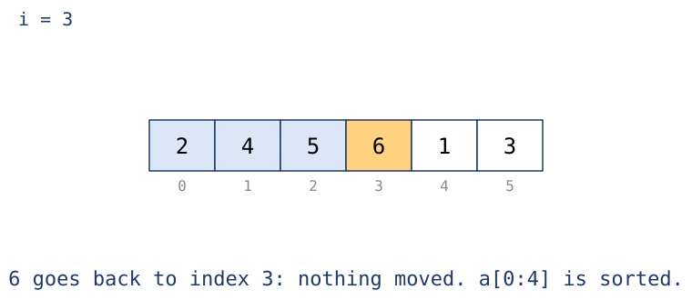{.fragment width=100%}
:::

## Insertion sort: step i = 5

::: {.r-stack}
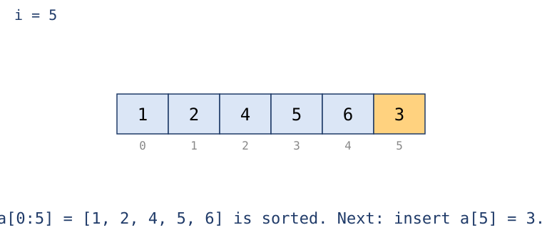{width=100%}

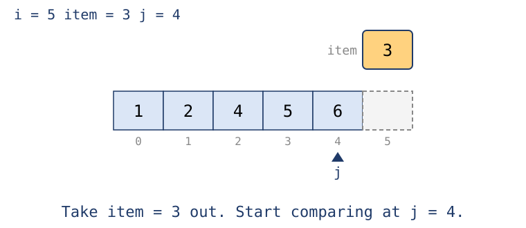{.fragment width=100%}

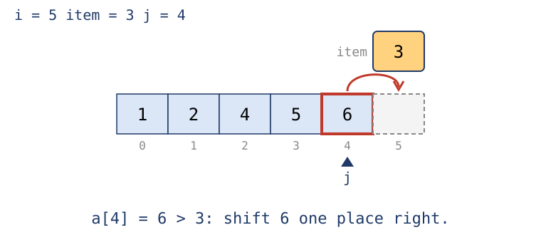{.fragment width=100%}

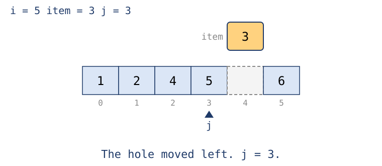{.fragment width=100%}

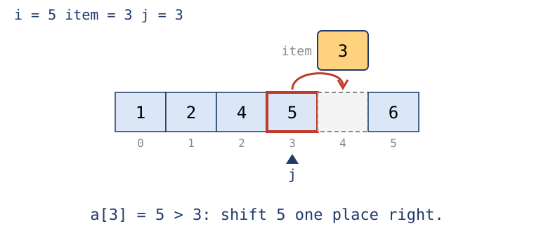{.fragment width=100%}

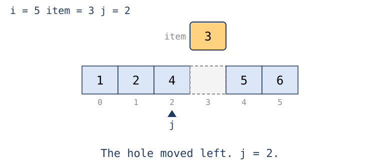{.fragment width=100%}

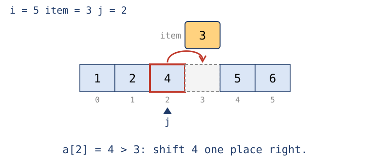{.fragment width=100%}

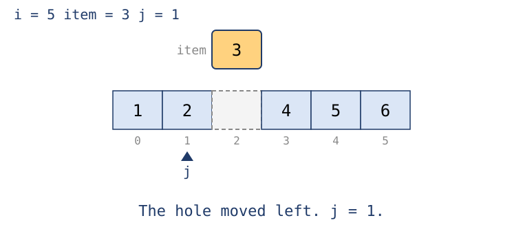{.fragment width=100%}

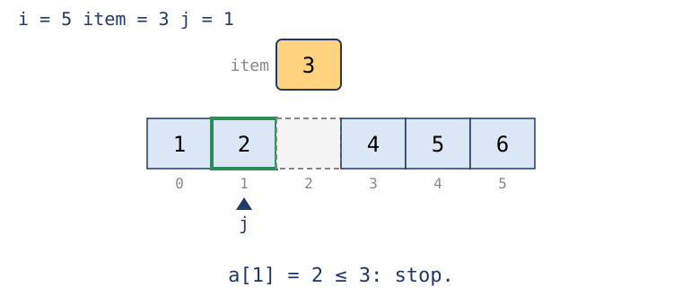{.fragment width=100%}

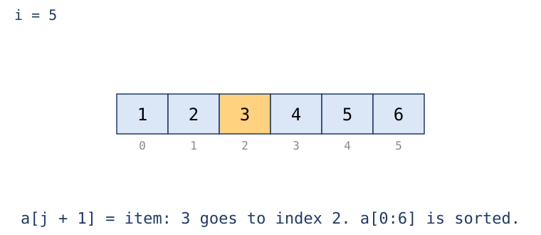{.fragment width=100%}
:::

## Insertion sort: all the steps

{height=520px}

## Insertion sort: the code

```python
def insertion_sort(a, key=lambda x: x):
    for i in range(1, len(a)):
        item = a[i]          # a[0:i] is sorted; insert a[i] into it
        j = i - 1
        while j >= 0 and key(a[j]) > key(item):
            a[j + 1] = a[j]  # shift a larger item one place to the right
            j -= 1
        a[j + 1] = item
```

- Sorts **in place**: no new list, only a few extra variables.
- **Stable**: `>` (not `>=`) — an item never moves past an equal one.
- `j >= 0` is checked **first**: `and` stops as soon as it is false.

## Insertion sort: how many steps?

Count the comparisons `key(a[j]) > key(item)`:

| input | comparisons | shifts |
|---|---|---|
| already sorted (best case) | $n - 1$ | $0$ |
| reversed (worst case) | $\dfrac{n(n-1)}{2}$ | $\dfrac{n(n-1)}{2}$ |
| random (average) | about $\dfrac{n^2}{4}$ | about $\dfrac{n^2}{4}$ |

- Worst case: item number $i$ moves all the way left: $1 + 2 + \dots + (n-1)$ — an arithmetic series.
- Average: each item moves about half way.
- Fast on lists that are **almost** sorted.

## Insertion sort: timing

Random floats, insertion sort vs Python's `sorted`:

| $n$ | insertion sort | `sorted` |
|---|---|---|
| 1,000 | ~18 ms | ~0.07 ms |
| 2,000 | ~75 ms | ~0.15 ms |
| 4,000 | ~330 ms | ~0.3 ms |
| 8,000 | ~1,200 ms | ~0.7 ms |

- Double $n$ → insertion sort takes about **4 times** longer ($n^2$).
- `sorted` takes a little more than twice as long — it uses a faster method, based on merge sort (the next topic).

See `code/insertion_sort.py` (exact times depend on the computer).

## Exercises

Exercises 11–15 in the exercises file (16 is a bonus).

# Merge sort

## Merge sort: the idea

- Insertion sort needs about $n^2/4$ steps: for a million items, about 250 billion.
- A different idea — **divide and conquer**:
  1. Split the list into two halves.
  2. Sort each half — the same way (recursion).
  3. **Merge** the two sorted halves into one sorted list.
- A list of 0 or 1 items is already sorted: nothing to do.

First: how do we merge two sorted lists?

## Merging two sorted lists

Two sorted piles of cards, face up:

- Compare the two top cards, and take the smaller one.
- Repeat until one of the piles is empty.
- Then take the rest of the other pile, as it is.

Each comparison moves **one** item to the result.

## Merging: step by step

::: {.r-stack}
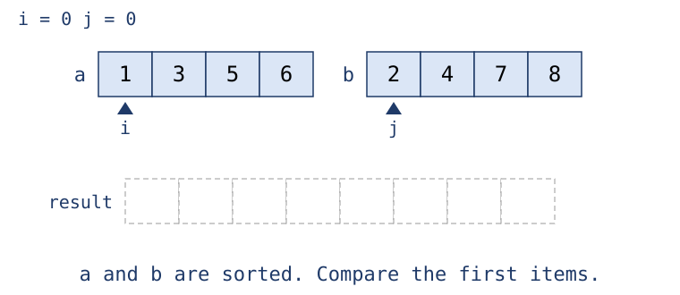{width=100%}

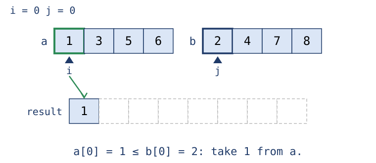{.fragment width=100%}

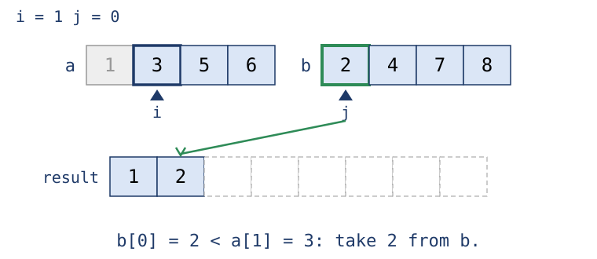{.fragment width=100%}

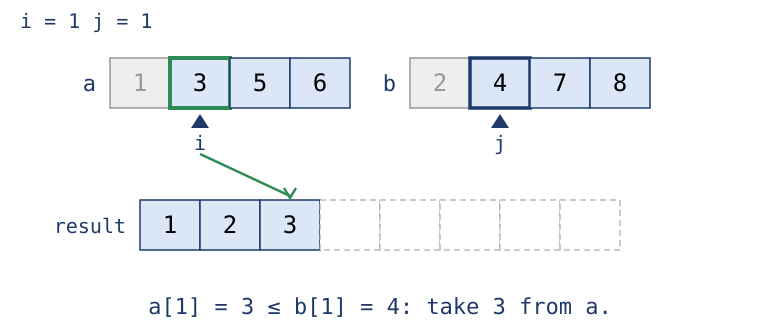{.fragment width=100%}

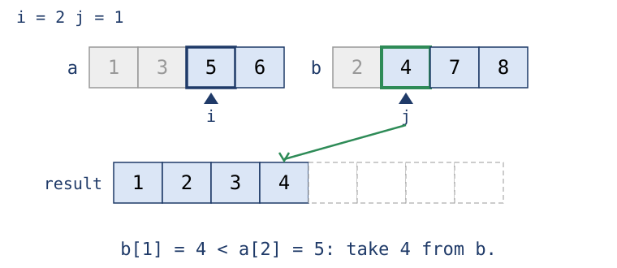{.fragment width=100%}

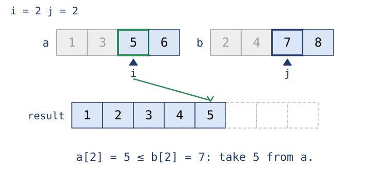{.fragment width=100%}

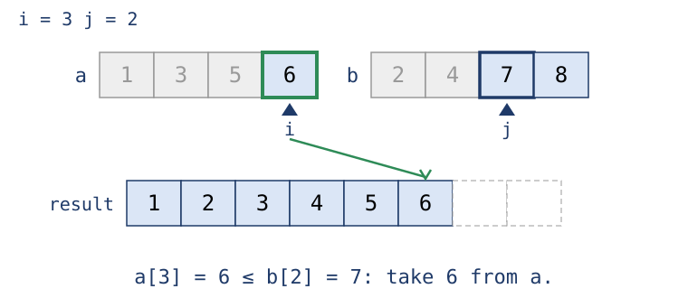{.fragment width=100%}

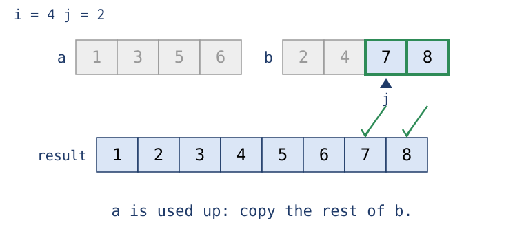{.fragment width=100%}

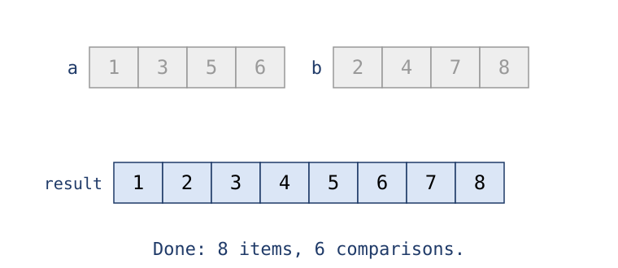{.fragment width=100%}
:::

## merge: the code

```python
def merge(a, b, key=lambda x: x):
    result = []
    i = 0
    j = 0
    while i < len(a) and j < len(b):
        if key(a[i]) <= key(b[j]):   # <= : on equal keys take from a first
            result.append(a[i])
            i += 1
        else:
            result.append(b[j])
            j += 1
    result.extend(a[i:])             # one of the lists is used up:
    result.extend(b[j:])             # copy the rest of the other one
    return result
```

- `<=`: on equal keys, the item from `a` goes first, so merging is **stable**.
- `extend` adds all the items of a list; `a[i:]` is empty if `a` is used up.

## merge: how many steps?

`a` and `b` together have $n$ items:

- Every item is copied to the result **once**: $n$ copies.
- Every comparison copies one item, and the last items are copied without comparing: at most $n - 1$ comparisons.
- In the example: 8 items, 6 comparisons.
- Extra memory: the new list, $n$ items.

`merge` is **linear**: the number of steps is proportional to $n$.

## Recursion: a reminder

A function that calls itself, on a **smaller** input:

```python
def largest(a):
    """The largest item of a non-empty list."""
    if len(a) == 1:              # base case: answer directly
        return a[0]
    mid = len(a) // 2
    return max(largest(a[:mid]), largest(a[mid:]))
```

- **Base case**: a small input with a direct answer. Without it, the calls never stop.
- Each call gets a smaller list, so the calls always reach the base case.
- `largest([6, 5, 3, 1, 8, 7, 2, 4])` is the larger of `largest([6, 5, 3, 1])` and `largest([8, 7, 2, 4])`.

## Merge sort: the code

```python
def merge_sort(a, key=lambda x: x):
    """Return a new sorted list, like sorted(a, key=key)."""
    if len(a) <= 1:
        return a[:]              # 0 or 1 items: already sorted
    mid = len(a) // 2
    left = merge_sort(a[:mid], key)
    right = merge_sort(a[mid:], key)
    return merge(left, right, key)
```

- The same structure as `largest`: a base case, two calls on the halves, then combine the answers.
- Returns a **new** list, like `sorted`: `a` itself does not change.
- **Stable**, because `merge` is stable.

## Merge sort: an example

::: {.r-stack}
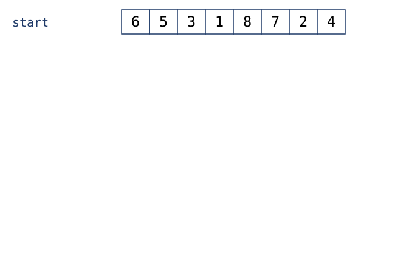{height=540px}

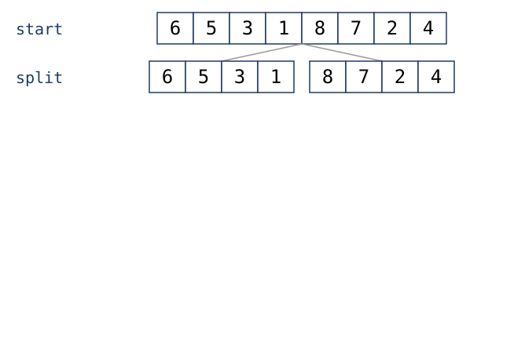{.fragment height=540px}

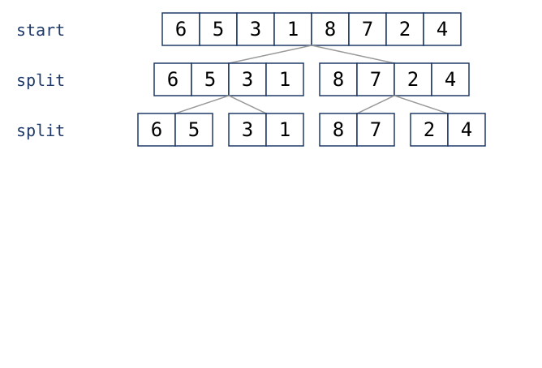{.fragment height=540px}

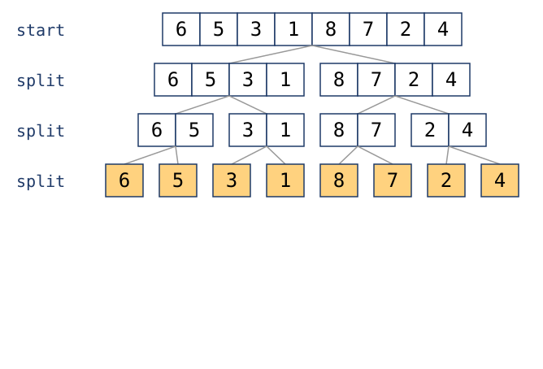{.fragment height=540px}

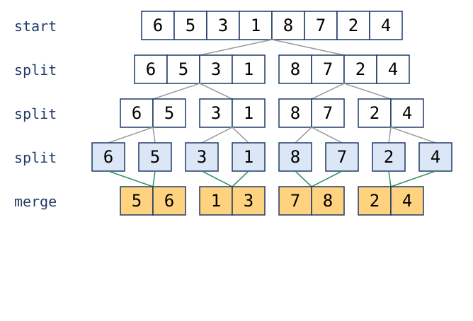{.fragment height=540px}

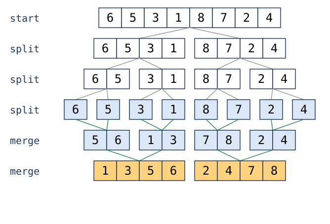{.fragment height=540px}

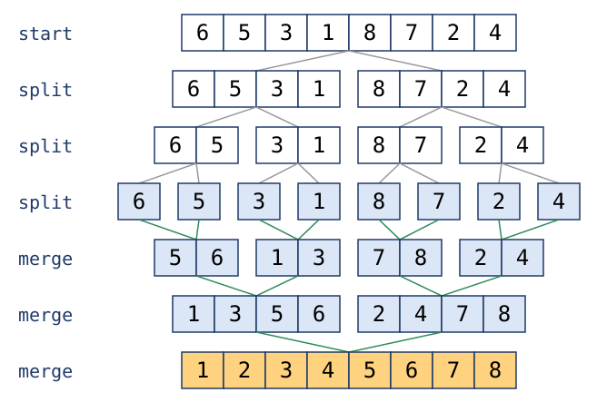{.fragment height=540px}
:::

## Merge sort: the calls

```text
merge_sort([6, 5, 3, 1])
    merge_sort([6, 5])
        merge_sort([6])
        merge_sort([5])
    -> merge([6], [5]) = [5, 6]
    merge_sort([3, 1])
        merge_sort([3])
        merge_sort([1])
    -> merge([3], [1]) = [1, 3]
-> merge([5, 6], [1, 3]) = [1, 3, 5, 6]
```

- Indentation = depth of the recursion.
- The left half is sorted completely before the right half starts.

See `merge_sort_traced` in `code/merge_sort.py`.

## Merge sort: how many steps?

- In the example, each **merge level** copies all $n$ items once: $n$ copies per level.
- The number of levels: how many times can we halve $n$? $\log_2 n$.
- Total: $n \log_2 n$ copies (exactly, when $n$ is a power of 2), and fewer comparisons.

| $n$ | merge sort: $n \log_2 n$ | insertion sort: about $n^2/4$ |
|---|---|---|
| 8 | 24 | 16 |
| 1,024 | 10,240 | 262,144 |
| 1,048,576 | 20,971,520 | 274,877,906,944 |

For small lists insertion sort is fine; for large lists $n^2$ grows much faster.

## The recurrence

$T(n)$ = the number of copies when sorting $n$ items:

$$
T(1) = 0 \qquad\qquad T(n) = \underbrace{2\,T(n/2)}_{\text{sort the two halves}} + \underbrace{n}_{\text{merge}}
$$

For $n = 8$:

$$
\begin{aligned}
T(2) &= 2\,T(1) + 2 = 2 \\
T(4) &= 2\,T(2) + 4 = 8 \\
T(8) &= 2\,T(4) + 8 = 24 = 8 \cdot 3 = 8 \log_2 8
\end{aligned}
$$

## Solving the recurrence

Substitute $T(n/2) = 2\,T(n/4) + n/2$, and so on ($n$ a power of 2):

$$
\begin{aligned}
T(n) &= 2\,T(n/2) + n \\
     &= 4\,T(n/4) + 2n \\
     &= 8\,T(n/8) + 3n \\
     &\;\;\vdots \\
     &= 2^k\,T(n/2^k) + k\,n
\end{aligned}
$$

Stop when $n/2^k = 1$, that is $k = \log_2 n$:

$$
T(n) = n \cdot T(1) + n \log_2 n = n \log_2 n
$$

## Merge sort: memory

- `merge` builds a new list: $n$ extra items at the top level.
- The slices `a[:mid]` and `a[mid:]` are copies too.
- Recursion depth: $\log_2 n$ calls wait for each other, each with its own variables.
- Extra memory proportional to $n$. Insertion sort sorts **in place**: only a few extra variables.

## Insertion sort vs merge sort

| | insertion sort | merge sort |
|---|---|---|
| already sorted | $n - 1$ comparisons | $\frac{1}{2} n \log_2 n$ comparisons |
| average | about $n^2/4$ | about $n \log_2 n$ |
| worst case | about $n^2/2$ | about $n \log_2 n$ |
| extra memory | a few variables | proportional to $n$ |
| stable | yes | yes |

## Merge sort: timing

| $n$ | insertion sort | merge sort | `sorted` |
|---|---|---|---|
| 1,000 | ~24 ms | ~2 ms | ~0.1 ms |
| 2,000 | ~100 ms | ~5 ms | ~0.2 ms |
| 4,000 | ~420 ms | ~9 ms | ~0.3 ms |
| 8,000 | ~1,600 ms | ~18 ms | ~0.8 ms |

- Double $n$: merge sort takes a little more than **twice** as long, insertion sort **4 times**.
- A million numbers: merge sort ~5 seconds; insertion sort about 7 hours.
- `sorted` uses Timsort: merge sort, with insertion sort for short pieces, written in C.

See `code/merge_sort.py` (exact times depend on the computer).
