# Introduction

## What is this course about?

- **Data structure**: a way to organize data in memory so that some operations are fast.
- **Algorithm**: a precise sequence of steps that solves a problem.
- The two go together: the structure decides which algorithms are possible, and how fast they are.

## Why does it matter?

Find one name in a list of 1,000,000 names:

| method | comparisons (worst case) |
|---|---|
| check every name | 1,000,000 |
| sorted list, binary search | 20 |

- Same computer, same language — a different algorithm.
- With 1,000,000,000 names: 1,000,000,000 vs **30**.

## How we measure

- Not seconds: they depend on the computer, the language, other programs...
- We count **steps** (comparisons, assignments, loop iterations) as a function of the input size `n`.
- We ask: how does the number of steps **grow** when `n` grows?
- Worst case, best case, average case.
- Memory: how much **extra** memory, beyond the input itself?

## Course topics

- Math tools: powers, logarithms, sums, recurrences, induction
- Searching: linear search, binary search
- Sorting: insertion sort, merge sort, quicksort, heap sort
- Asymptotic notation: $O$, $\Omega$, $\Theta$
- Heaps and priority queues, quickselect
- Linked lists, stacks and queues (linked list, circular buffer)
- Binary search trees
- Hash tables

## Python

- Example code and exercises will be in Python.
- Python already has lists, `sorted`, `dict`, `set`, `bisect`, `heapq`...
- We implement the algorithms ourselves to understand **how** they work and **what they cost**.
- Then we know which built-in tool to choose, and why.

# Powers and logarithms

## Powers

$$
a^n = \underbrace{a \cdot a \cdots a}_{n \text{ times}}
\qquad 2^3 = 8 \qquad 10^6 = 1{,}000{,}000
$$

$$
a^m \cdot a^n = a^{m+n} \qquad \frac{a^m}{a^n} = a^{m-n} \qquad (a^m)^n = a^{m \cdot n}
$$

. . .

The rules decide what non-natural powers mean:

- $a^0 \cdot a^n = a^{0+n} = a^n \;\Rightarrow\; a^0 = 1$
- $a^{-n} \cdot a^n = a^0 = 1 \;\Rightarrow\; a^{-n} = \dfrac{1}{a^n}$
- $a^{1/2} \cdot a^{1/2} = a^1 \;\Rightarrow\; a^{1/2} = \sqrt{a}$

## Powers of 2

| $k$ | $2^k$ | about |
|---|---|---|
| 8 | 256 | |
| 10 | 1,024 | $10^3$ (thousand) |
| 20 | 1,048,576 | $10^6$ (million) |
| 30 | 1,073,741,824 | $10^9$ (billion) |
| 64 | 18,446,744,073,709,551,616 | $16 \cdot 10^{18}$ |

$2^{10} \approx 10^3$ is a useful approximation in this course.

$2^{64} = 2^{4} \cdot (2^{10})^6 \approx 16 \cdot (10^3)^6 = 16 \cdot 10^{18}$

## Logarithms

$\log_b x$ :\
**to what power do we raise $b$ to get $x$?**

$$
\log_b x = y \iff b^y = x
$$

- $\log_2 8 = 3$ because $2^3 = 8$
- $\log_2 1024 = 10$, $\log_2 1 = 0$, $\log_2 2 = 1$
- $\log_{10} 1{,}000{,}000 = 6$
- $\log_2 1{,}000{,}000 \approx 20$

In this course, $\log n$ without a base means $\log_2 n$.

## Logarithm rules

From the power rules:

$$
\log_b (x \cdot y) = \log_b x + \log_b y
$$

Proof:

Define: $m=\log_b x$, and $n=\log_b y$.

$\Rightarrow x = b^m$, $y = b^n$.

$\Rightarrow x \cdot y = b^m \cdot b^n = b^{m+n}$

$\Rightarrow\log_b(x \cdot y) = m + n$.

$\blacksquare$


## Logarithm rules (contd.)

$$
\log_b \frac{x}{y} = \log_b x - \log_b y
\qquad
\log_b x^k = k \cdot \log_b x
$$

Example: $\log_2 (1000 \cdot 1000) = \log_2 1000 + \log_2 1000 \approx 10 + 10 = 20$

## Change of base

$$
\log_b x = \frac{\log_a x}{\log_a b}
$$

- $\log_8 1024 = \dfrac{\log_2 1024}{\log_2 8} = \dfrac{10}{3} = 3.33...$
- $\dfrac{\log_2 n}{\log_{10} n} = \log_2 10 \approx 3.32$ — for **every** $n$.

All logarithms differ only by a constant factor.
That is why we often do not care about the base.

## How many times can we halve $n$?

$n \to n/2 \to n/4 \to \dots \to 1$

After $k$ halvings we have $n / 2^k$. We stop when $n / 2^k = 1$, that is $2^k = n$:

$$
k = \log_2 n
$$

| $n$ | 1,000 | 1,000,000 | 1,000,000,000 |
|---|---|---|---|
| halvings | ~10 | ~20 | ~30 |

The same for any constant fraction: dividing by 3, or keeping $3/4$ each time — still about $\log n$ steps (with a different base).

## In Python

```python
import math

math.log2(1024)         # 10.0
math.log2(1_000_000)    # 19.931568569324174
math.log(1024, 8)       # 3.3333333333333335
math.log10(1_000_000)   # 6.0
2 ** 64                 # 18446744073709551616  (Python ints have no size limit)
```

## Exercises

Exercises 1–3 in the exercises file.

# Sums

## Arithmetic series

$$
1 + 2 + 3 + \dots + n = \sum_{i=1}^{n} i = \frac{n(n+1)}{2}
$$

Pair the first with the last:

```text
  1 +   2 +   3 + ... + 100
100 +  99 +  98 + ... +   1
---------------------------
101 + 101 + 101 + ... + 101   = 100 · 101 = 2 × (the sum)
```

So $1 + \dots + 100 = \dfrac{100 \cdot 101}{2} = 5050$.

For large $n$: about $\dfrac{n^2}{2}$.

## Where it appears: nested loops

```python
count = 0
for i in range(n):
    for j in range(i):
        count += 1
```

- Inner loop runs $0, 1, 2, \dots, n-1$ times.
- Total: $0 + 1 + \dots + (n-1) = \dfrac{n(n-1)}{2}$
- $n = 1000$: 499,500 — about half of $n^2$.

See `code/count_steps.py`.

## Geometric series

$$
1 + 2 + 4 + \dots + 2^k = \sum_{i=0}^{k} 2^i = 2^{k+1} - 1
$$

In binary: `1 + 10 + 100 + 1000 = 1111`, and `1111 + 1 = 10000`.

## Proof by induction

Claim: $\sum_{i=0}^{k} 2^i = 2^{k+1} - 1$ for every $k \ge 0$.

- **Base**: $k = 0$: $2^0 = 1 = 2^1 - 1$. ✓
- **Step**: assume it holds for $k$. Then

$$
\sum_{i=0}^{k+1} 2^i = \underbrace{\sum_{i=0}^{k} 2^i}_{2^{k+1} - 1} + 2^{k+1} = 2 \cdot 2^{k+1} - 1 = 2^{k+2} - 1
$$

which is the claim for $k + 1$. ✓

## Geometric series: any ratio

In general, for $q \ne 1$:

$$
\sum_{i=0}^{k} q^i = \frac{q^{k+1} - 1}{q - 1}
$$

- $q = 2$: $\dfrac{2^{k+1} - 1}{1}$
- $q = \frac{1}{2}$: $1 + \frac12 + \frac14 + \dots < 2$ — always.

## Exercises

Exercises 4–5 in the exercises file.

# Searching

## Linear search

```python
def linear_search(a, target):
    for i in range(len(a)):
        if a[i] == target:
            return i
    return None
```

- Works on **any** list, sorted or not.
- Best case: 1 comparison. Worst case (last, or not found): $n$.
- Average (target is in the list, every position equally likely): about $n/2$.
- Python's `target in a` and `a.index(target)` are linear searches too.

## Lists of records

Often the items are records, and we search by one field:

```python
scientists = [("Curie", "Marie", 1898),
              ("Darwin", "Charles", 1859),
              ("Lovelace", "Ada", 1843),
              ("Newton", "Isaac", 1687)]
```

In this example we use a Python tuple as a record.

If we want to search for a scientist with the first name `"Isaac"`, the previous function will not work.

`linear_search(scientists, "Isaac")` returns `None`.

💡 Why?

## Searching by a field (1)

If we want to search by a specific field, we first need to define a function that gets a record and returns the field we search by:

```python
def last_name(s):
    return s[0]

def first_name(s):
    return s[1]

last_name(scientists[0])    # 'Curie'
first_name(scientists[3])   # 'Isaac'
```

## Searching by a field (2)

Then we add an additional parameter to `linear_search`, which is the "field" function.

The standard name for such a function is `key`.

```python
def linear_search(a, target, key):
    for i in range(len(a)):
        if key(a[i]) == target:
            return i
    return None

linear_search(scientists, "Newton", last_name)   # 3
linear_search(scientists, "Ada", first_name)     # 2
linear_search(scientists, "Curie", first_name)   # None
```

- `linear_search` does not know which field it compares: `key` decides.

## Python functions are values

In Python a function is a value, like a number or a string: it can be assigned to a variable and passed to another function.

```python
f = last_name                     # no parentheses: f is the same function
f(scientists[0])                  # 'Curie'

print(last_name)                  # <function last_name at 0x...>
print(last_name(scientists[0]))   # Curie
```

- `last_name` (no parentheses) is a reference to the function; it does not call it.
- `last_name(s)` calls it.

## Lambda: a function without a name

A short function can be written in one expression:

```python
def year(s):
    return s[2]

year = lambda s: s[2]       # the same function
```

- In `lambda s: s[2]`, the parameter is `s` and the value returned is `s[2]` (no `return`).
- Usually written directly in the call, without a name:

```python
linear_search(scientists, 1843, lambda s: s[2])     # 2
```

## A default key

```python
def linear_search(a, target, key=lambda x: x):
    for i in range(len(a)):
        if key(a[i]) == target:
            return i
    return None

linear_search([7, 3, 9], 9)                          # 2
linear_search(scientists, 1843, key=lambda s: s[2])  # 2
```

- The default `key` is the identity function: it returns the item itself.
- Python's `sorted`, `min` and `max` have the same `key` parameter.

## Binary search: the idea

The list is **sorted**. Look at the middle item:

- equal to the target: found;
- target is smaller: continue in the left half only;
- target is larger: continue in the right half only.

Each step throws away half of the candidates.

Like searching a word in a printed dictionary, or a guessing game: "I'm thinking of a number between 1 and 1000" — 10 questions are enough.

## Binary search: an example

Search for 41:

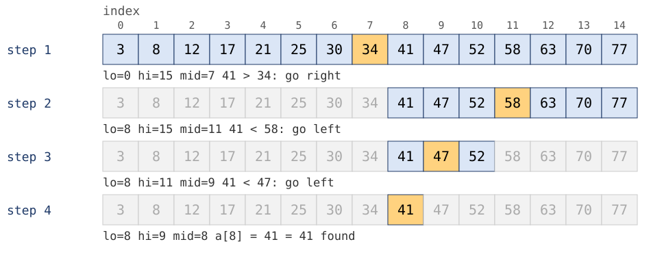{width=100%}

## Binary search: the code

```python
def binary_search(a, target):
    lo = 0           # first index that may still hold target
    hi = len(a)      # one past the last index that may still hold target
    while lo < hi:
        mid = (lo + hi) // 2
        if a[mid] == target:
            return mid
        if target < a[mid]:
            hi = mid         # target can only be left of mid
        else:
            lo = mid + 1     # target can only be right of mid
    return None
```

- The candidates are always `a[lo:hi]` (`hi` not included).
- `lo == hi`: no candidates left — not found.
- Easy to get wrong: `hi = mid` vs `hi = mid - 1`, `lo < hi` vs `lo <= hi`. Keep **one** convention.

## Binary search: how many steps?

- Each step: candidates go from $m$ to at most $m/2$.
- At most $\lfloor \log_2 n \rfloor + 1$ steps.

| $n$ | linear (worst) | binary (worst) |
|---|---|---|
| 10 | 10 | 4 |
| 100 | 100 | 7 |
| 1,000 | 1,000 | 10 |
| 1,000,000 | 1,000,000 | 20 |

- The price: the list must be sorted (sorting is the next topic).
- Worth it when we search the same list many times.

See `code/search.py`.

## In Python: `bisect`

```python
import bisect

a = [1, 3, 3, 3, 7]
bisect.bisect_left(a, 3)    # 1  first index where 3 could be inserted
bisect.bisect_right(a, 3)   # 4  last index where 3 could be inserted
bisect.bisect_left(a, 4)    # 4  4 is not in a: this is where it would go
```

- Binary search that returns a **position**, not "found / not found".
- Found? Check `i < len(a) and a[i] == target`.
- Also has a `key` parameter (Python 3.10+).

## Timing

1,000,000 sorted numbers, average time of one search:

| method | time |
|---|---|
| `t in numbers` (list, linear) | tens of milliseconds |
| `bisect` (binary search) | ~2 microseconds |
| `t in as_set` (set) | ~0.2 microseconds |

- Binary search is ~10,000 times faster than linear here.
- `set` is even faster — it is a **hash table** (end of the course).

See `code/search_timing.py` (exact times depend on the computer).

## Exercises

Exercises 6–9 in the exercises file.

# Sorting

## Sorting in Python

```python
grades = [("Dana", 90), ("Noa", 85), ("Tamar", 90),
          ("Rivka", 85), ("Lea", 95)]

sorted(grades, key=lambda g: g[1])
# [('Noa', 85), ('Rivka', 85), ('Dana', 90), ('Tamar', 90), ('Lea', 95)]

sorted(grades, key=lambda g: g[1], reverse=True)
# [('Lea', 95), ('Dana', 90), ('Tamar', 90), ('Noa', 85), ('Rivka', 85)]
```

- `sorted(a)` returns a **new** sorted list; `a.sort()` sorts `a` **in place** (and returns `None`).
- Both take `key` and `reverse`.
- Two keys: `key=lambda g: (-g[1], g[0])` — by grade descending, then by name.

## Stability

A sort is **stable** if items with equal keys keep their original order.

```python
grades = [("Dana", 90), ("Noa", 85), ("Tamar", 90),
          ("Rivka", 85), ("Lea", 95)]
sorted(grades, key=lambda g: g[1])
# [('Noa', 85), ('Rivka', 85), ('Dana', 90), ('Tamar', 90), ('Lea', 95)]
```

- Noa before Rivka, Dana before Tamar — as in the input.
- Python's `sorted` is always stable.
- Why it matters: sort by name, then (stably) by grade → sorted by grade, and by name within each grade.

## Insertion sort: the idea

Like sorting cards in your hand:

- The left part of the list is already sorted (at first: one item).
- Take the next item, and move it left until the item before it is not larger.
- Larger items shift one place to the right to make room.
- Repeat until the sorted part is the whole list.

## Insertion sort: step i = 1

::: {.r-stack}
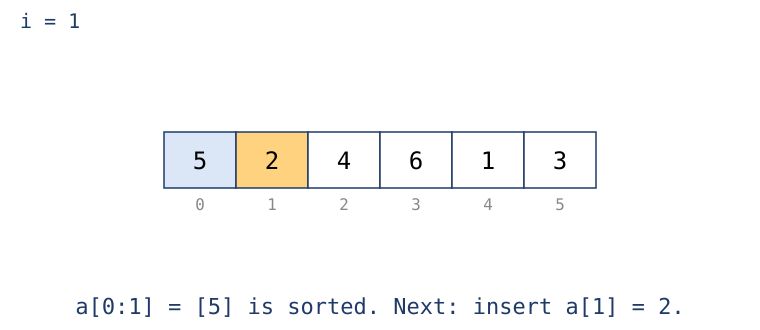{width=100%}

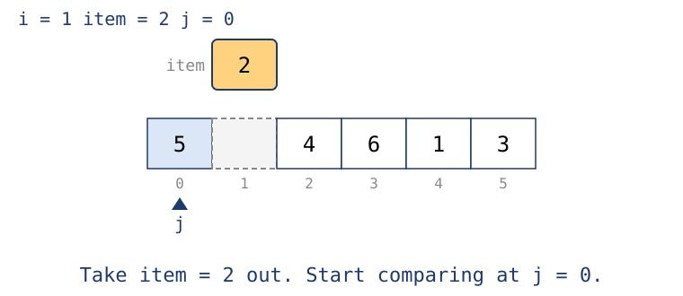{.fragment width=100%}

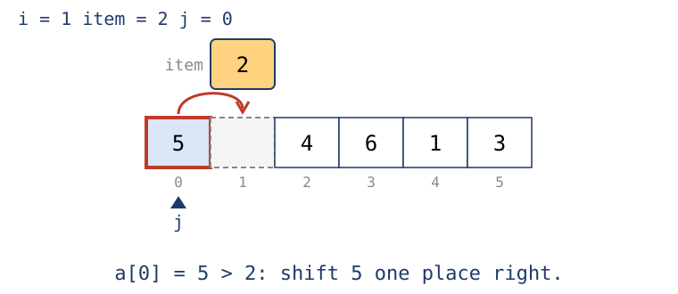{.fragment width=100%}

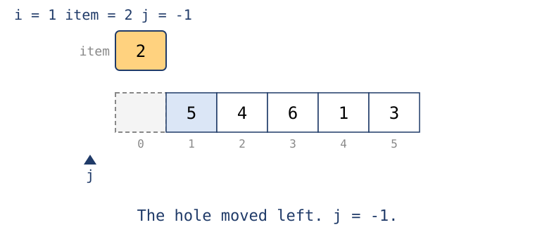{.fragment width=100%}

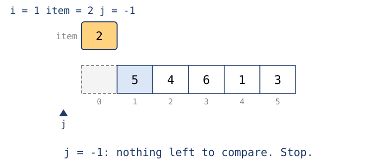{.fragment width=100%}

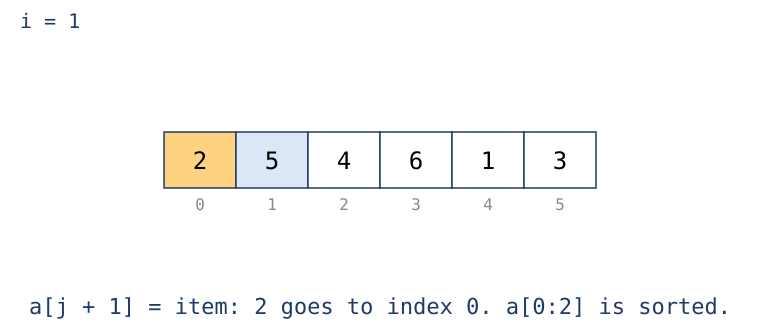{.fragment width=100%}
:::

## Insertion sort: step i = 2

::: {.r-stack}
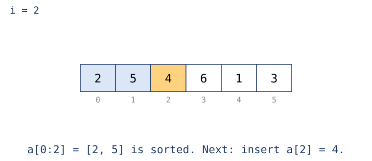{width=100%}

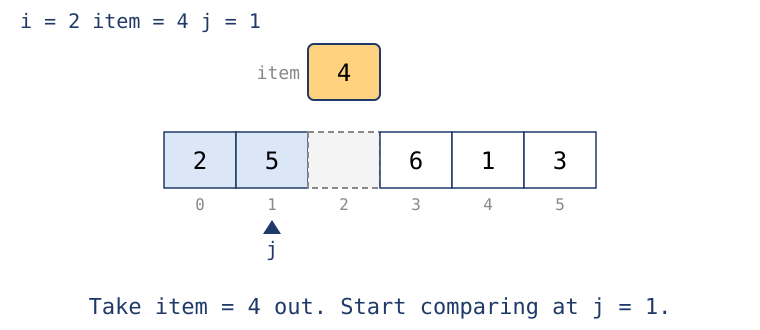{.fragment width=100%}

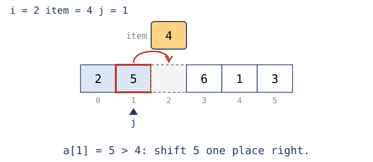{.fragment width=100%}

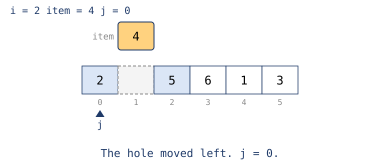{.fragment width=100%}

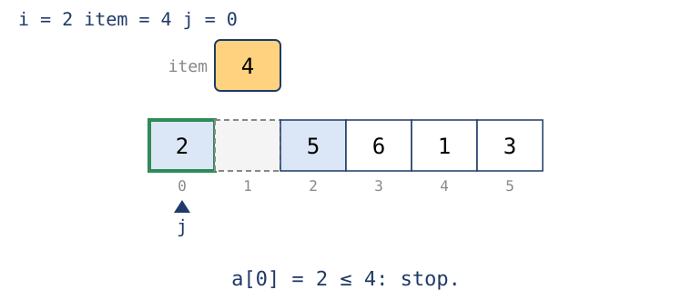{.fragment width=100%}

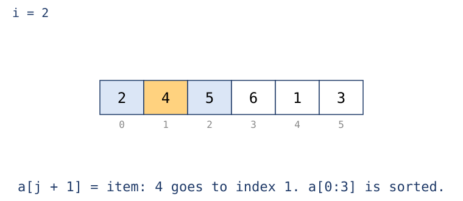{.fragment width=100%}
:::

## Insertion sort: step i = 3

::: {.r-stack}
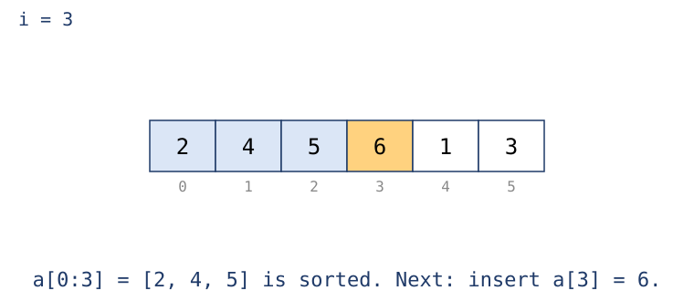{width=100%}

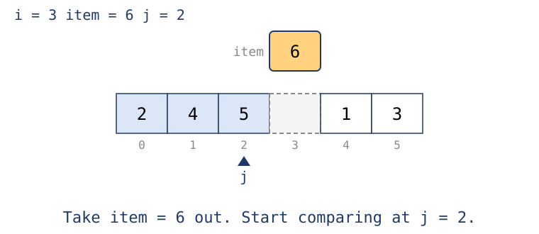{.fragment width=100%}

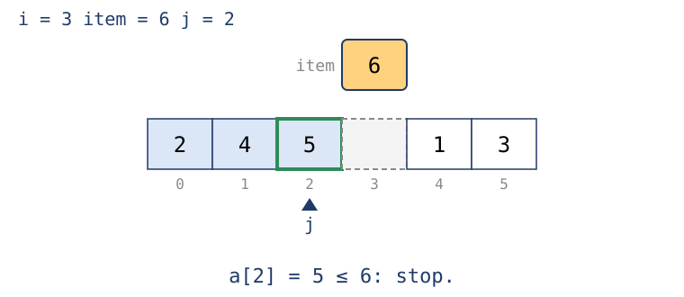{.fragment width=100%}

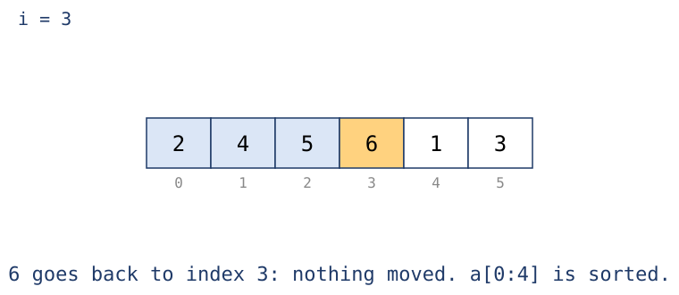{.fragment width=100%}
:::

## Insertion sort: step i = 5

::: {.r-stack}
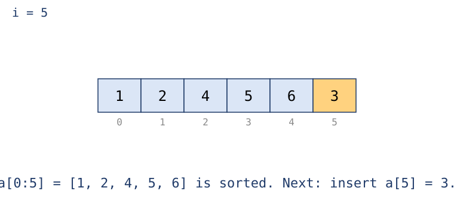{width=100%}

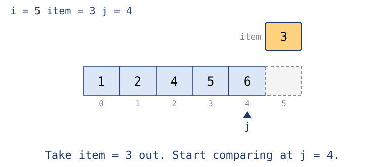{.fragment width=100%}

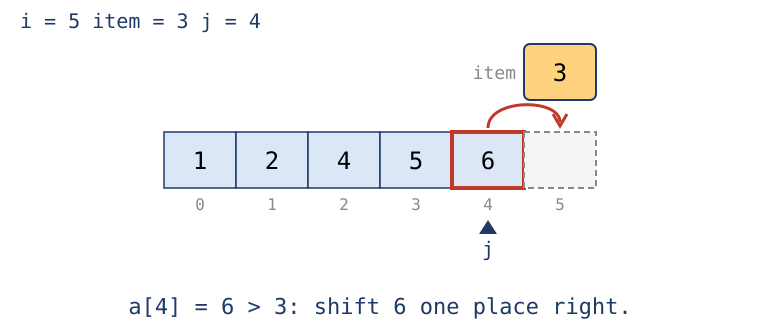{.fragment width=100%}

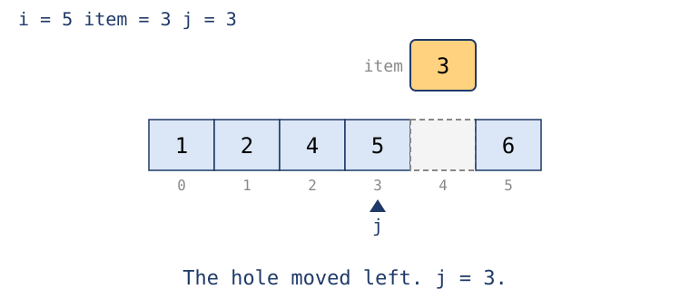{.fragment width=100%}

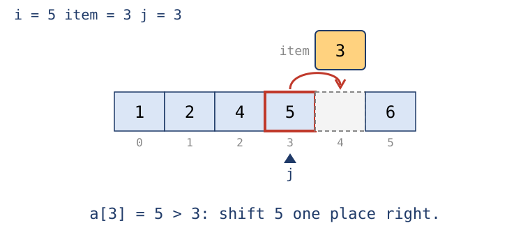{.fragment width=100%}

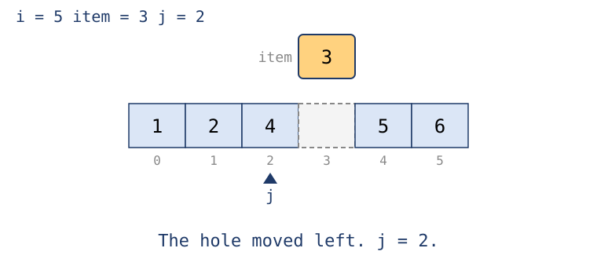{.fragment width=100%}

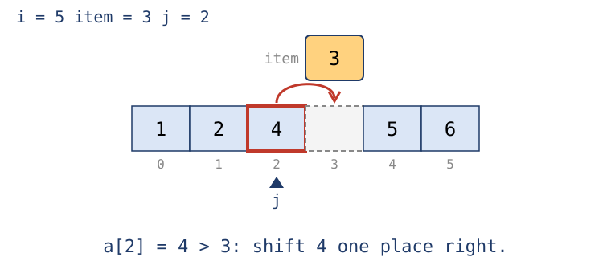{.fragment width=100%}

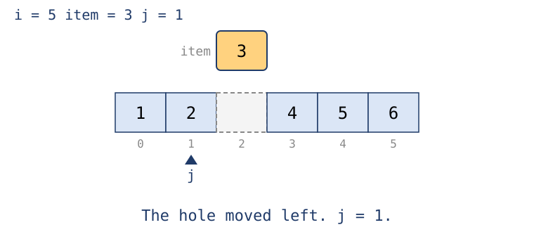{.fragment width=100%}

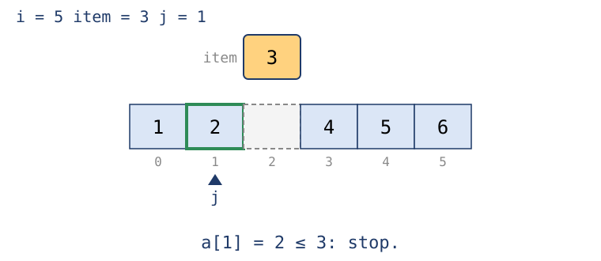{.fragment width=100%}

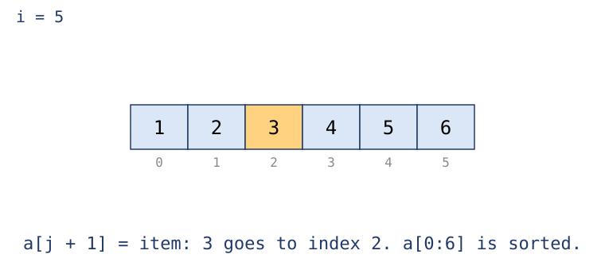{.fragment width=100%}
:::

## Insertion sort: all the steps

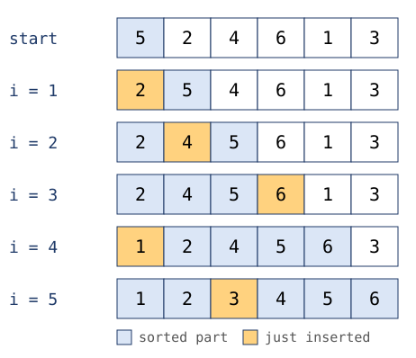{height=520px}

## Insertion sort: the code

```python
def insertion_sort(a, key=lambda x: x):
    for i in range(1, len(a)):
        item = a[i]          # a[0:i] is sorted; insert a[i] into it
        j = i - 1
        while j >= 0 and key(a[j]) > key(item):
            a[j + 1] = a[j]  # shift a larger item one place to the right
            j -= 1
        a[j + 1] = item
```

- Sorts **in place**: no new list, only a few extra variables.
- **Stable**: `>` (not `>=`) — an item never moves past an equal one.
- `j >= 0` is checked **first**: `and` stops as soon as it is false.

## Insertion sort: how many steps?

Count the comparisons `key(a[j]) > key(item)`:

| input | comparisons | shifts |
|---|---|---|
| already sorted (best case) | $n - 1$ | $0$ |
| reversed (worst case) | $\dfrac{n(n-1)}{2}$ | $\dfrac{n(n-1)}{2}$ |
| random (average) | about $\dfrac{n^2}{4}$ | about $\dfrac{n^2}{4}$ |

- Worst case: item number $i$ moves all the way left: $1 + 2 + \dots + (n-1)$ — an arithmetic series.
- Average: each item moves about half way.
- Fast on lists that are **almost** sorted.

## Insertion sort: timing

Random floats, insertion sort vs Python's `sorted`:

| $n$ | insertion sort | `sorted` |
|---|---|---|
| 1,000 | ~18 ms | ~0.07 ms |
| 2,000 | ~75 ms | ~0.15 ms |
| 4,000 | ~330 ms | ~0.3 ms |
| 8,000 | ~1,200 ms | ~0.7 ms |

- Double $n$ → insertion sort takes about **4 times** longer ($n^2$).
- `sorted` takes a little more than twice as long — it uses a faster method, based on merge sort (the next topic).

See `code/insertion_sort.py` (exact times depend on the computer).

## Exercises

Exercises 11–15 in the exercises file (16 is a bonus).

# Merge sort

## Merge sort: the idea

- Insertion sort needs about $n^2/4$ steps: for a million items, about 250 billion.
- A different idea — **divide and conquer**:
  1. Split the list into two halves.
  2. Sort each half — the same way (recursion).
  3. **Merge** the two sorted halves into one sorted list.
- A list of 0 or 1 items is already sorted: nothing to do.

First: how do we merge two sorted lists?

## Merging two sorted lists

Two sorted piles of cards, face up:

- Compare the two top cards, and take the smaller one.
- Repeat until one of the piles is empty.
- Then take the rest of the other pile, as it is.

Each comparison moves **one** item to the result.

## Merging: step by step

::: {.r-stack}
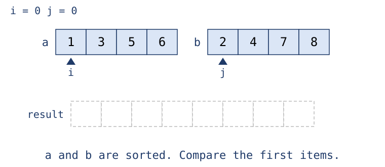{width=100%}

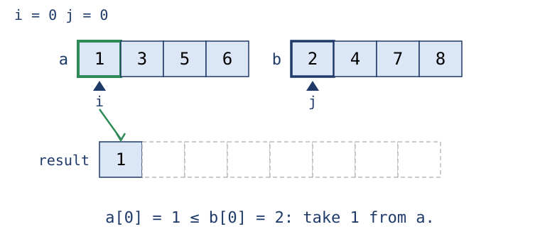{.fragment width=100%}

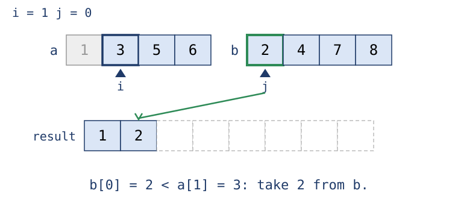{.fragment width=100%}

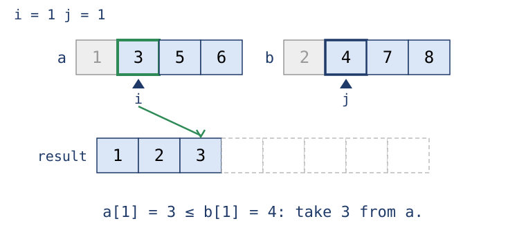{.fragment width=100%}

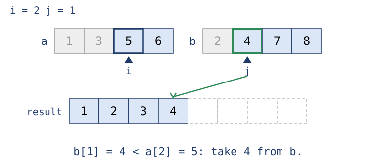{.fragment width=100%}

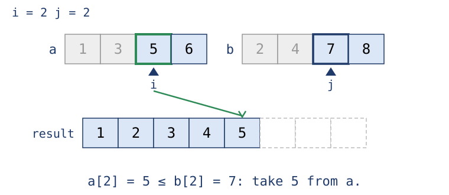{.fragment width=100%}

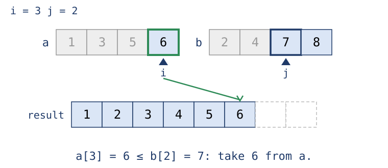{.fragment width=100%}

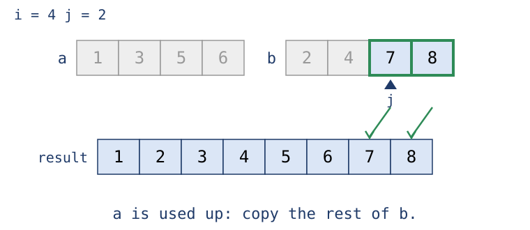{.fragment width=100%}

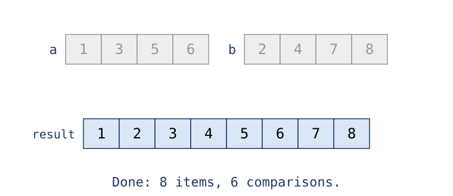{.fragment width=100%}
:::

## merge: the code

```python
def merge(a, b, key=lambda x: x):
    result = []
    i = 0
    j = 0
    while i < len(a) and j < len(b):
        if key(a[i]) <= key(b[j]):   # <= : on equal keys take from a first
            result.append(a[i])
            i += 1
        else:
            result.append(b[j])
            j += 1
    result.extend(a[i:])             # one of the lists is used up:
    result.extend(b[j:])             # copy the rest of the other one
    return result
```

- `<=`: on equal keys, the item from `a` goes first, so merging is **stable**.
- `extend` adds all the items of a list; `a[i:]` is empty if `a` is used up.

## merge: how many steps?

`a` and `b` together have $n$ items:

- Every item is copied to the result **once**: $n$ copies.
- Every comparison copies one item, and the last items are copied without comparing: at most $n - 1$ comparisons.
- In the example: 8 items, 6 comparisons.
- Extra memory: the new list, $n$ items.

`merge` is **linear**: the number of steps is proportional to $n$.

## Recursion: a reminder

A function that calls itself, on a **smaller** input:

```python
def largest(a):
    """The largest item of a non-empty list."""
    if len(a) == 1:              # base case: answer directly
        return a[0]
    mid = len(a) // 2
    return max(largest(a[:mid]), largest(a[mid:]))
```

- **Base case**: a small input with a direct answer. Without it, the calls never stop.
- Each call gets a smaller list, so the calls always reach the base case.
- `largest([6, 5, 3, 1, 8, 7, 2, 4])` is the larger of `largest([6, 5, 3, 1])` and `largest([8, 7, 2, 4])`.

## Merge sort: the code

```python
def merge_sort(a, key=lambda x: x):
    """Return a new sorted list, like sorted(a, key=key)."""
    if len(a) <= 1:
        return a[:]              # 0 or 1 items: already sorted
    mid = len(a) // 2
    left = merge_sort(a[:mid], key)
    right = merge_sort(a[mid:], key)
    return merge(left, right, key)
```

- The same structure as `largest`: a base case, two calls on the halves, then combine the answers.
- Returns a **new** list, like `sorted`: `a` itself does not change.
- **Stable**, because `merge` is stable.

## Merge sort: an example

::: {.r-stack}
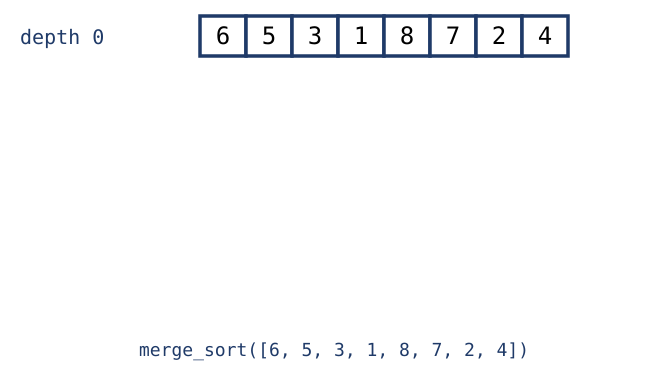{height=470px}

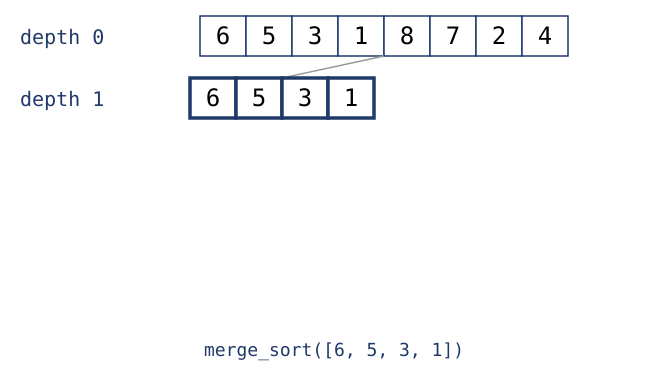{.fragment height=470px}

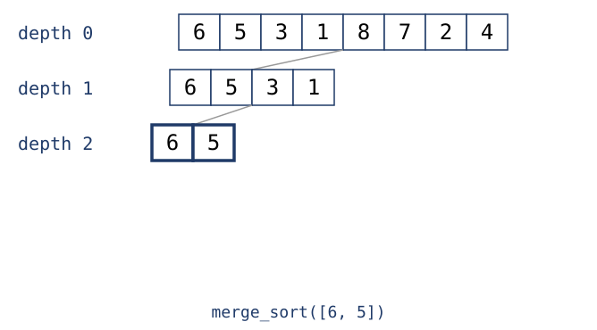{.fragment height=470px}

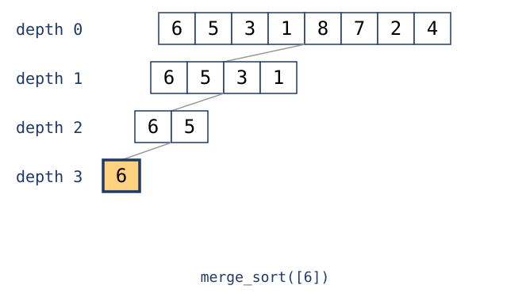{.fragment height=470px}

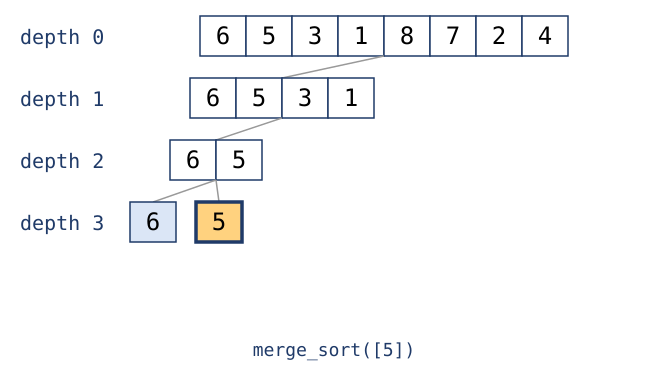{.fragment height=470px}

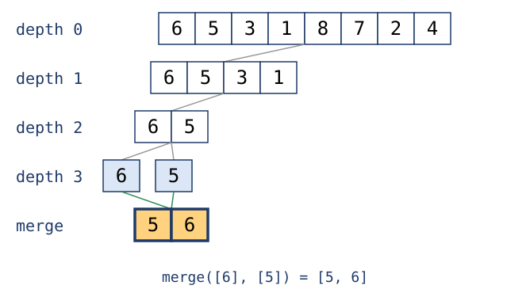{.fragment height=470px}

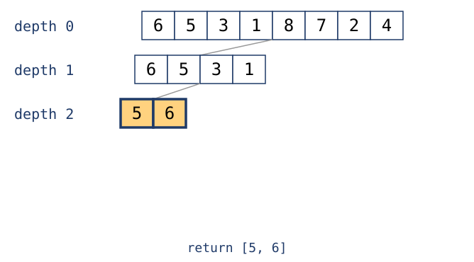{.fragment height=470px}

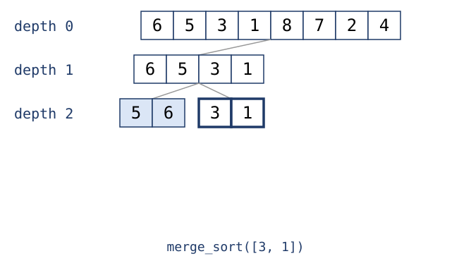{.fragment height=470px}

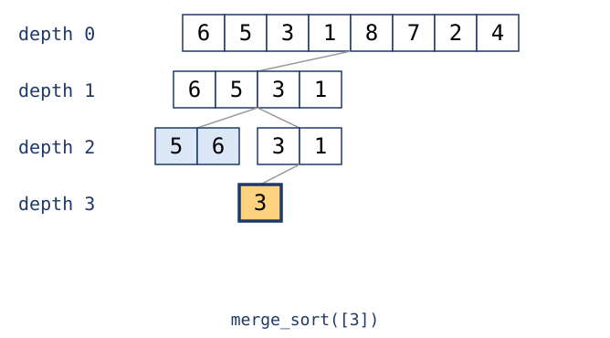{.fragment height=470px}

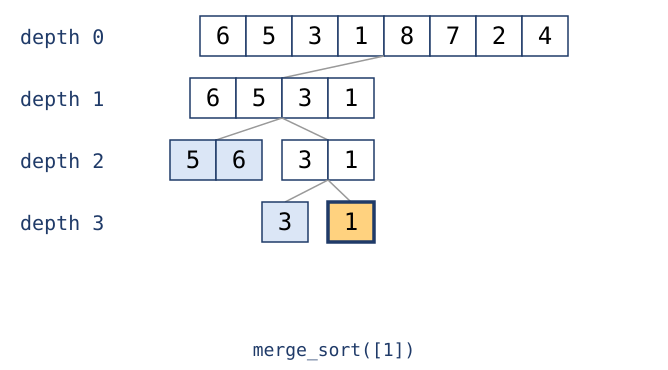{.fragment height=470px}

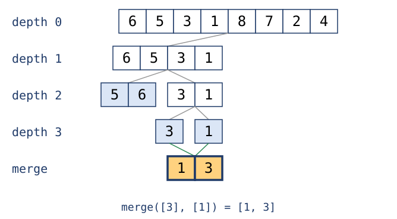{.fragment height=470px}

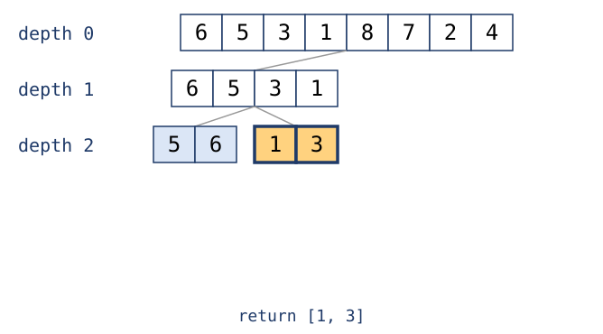{.fragment height=470px}

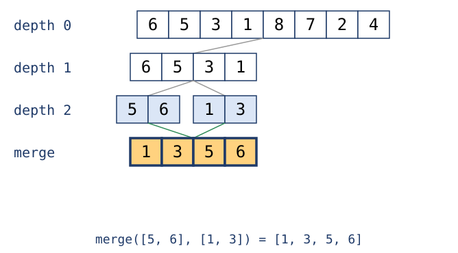{.fragment height=470px}

{.fragment height=470px}

{.fragment height=470px}

{.fragment height=470px}

{.fragment height=470px}

{.fragment height=470px}

{.fragment height=470px}

{.fragment height=470px}

{.fragment height=470px}

{.fragment height=470px}

{.fragment height=470px}

{.fragment height=470px}

{.fragment height=470px}

{.fragment height=470px}

{.fragment height=470px}

{.fragment height=470px}

{.fragment height=470px}
:::

## Merge sort: the calls

```text
merge_sort([6, 5, 3, 1])
    merge_sort([6, 5])
        merge_sort([6])
        merge_sort([5])
    -> merge([6], [5]) = [5, 6]
    merge_sort([3, 1])
        merge_sort([3])
        merge_sort([1])
    -> merge([3], [1]) = [1, 3]
-> merge([5, 6], [1, 3]) = [1, 3, 5, 6]
```

- Indentation = depth of the recursion.
- The left half is sorted completely before the right half starts.

See `merge_sort_traced` in `code/merge_sort.py`.

## Merge sort: number of steps

**Claim**: the number of steps merge sort needs to sort a list of $n$ items ($n$ a power of 2) is

$$
T(n) = n \log_2 n
$$

- First an intuition: count the copies.
- Then a proof: a recurrence formula, and induction.

## Merge sort: counting the copies

::: {.r-stack}
{height=480px}

{.fragment height=480px}

{.fragment height=480px}

{.fragment height=480px}

{.fragment height=480px}
:::

## Merge sort: counting the number of steps

- Each **merge level** copies $n$ items.\
  Number of comparisons can be less, because "tails" can be merged without comparison.
- Number of levels:\
  The number of times we can halve $n$: $\quad\log_2 n$.
- Total: $\quad n \log_2 n$\
  Copies: $\quad n \log_2 n$ (exactly, when $n$ is a power of 2)\
  Comparisons: fewer.

## Merge sort vs. insertion sort

| $n$ | merge sort: $n \log_2 n$ | insertion sort: about $n^2/4$ |
|---|---|---|
| 8 | 24 | 16 |
| 1,024 | 10,240 | 262,144 |
| 1,048,576 | 20,971,520 | 274,877,906,944 |

For small lists insertion sort is fine; for large lists $n^2$ grows much faster.

## Recurrence formula for merge sort

$T(n)$ = number of steps when sorting $n$ items:

$$
T(1) = 0 \qquad\qquad T(n) = \underbrace{2\,T(n/2)}_{\text{sort the two halves}} + \underbrace{n}_{\text{merge}}
$$

For $n=2$ and $n=4$:
$$
\begin{aligned}
T(2) &= 2\,T(1) + 2 = 2\\
T(4) &= 2\,T(2) + 4 = 4 + 4 = 8
\end{aligned}
$$

## The recurrence for $n = 8$

$$
T(n) = 2\,T(n/2) + n
$$


$$
\begin{aligned}
T(8) &= 2\,\bbox[2px,border:1px solid #2e8b57]{\color{#2e8b57}{T(4)}} + 8 \\
&\class{fragment}{= 2\,\bbox[2px,border:1px solid #2e8b57]{\color{#2e8b57}{(2\,T(2) + 4)}} + 8} \\
&\class{fragment}{= (4\,T(2) + 8) + 8} \\
&\class{fragment}{= 4\,\bbox[2px,border:1px solid #1f5fbf]{\color{#1f5fbf}{T(2)}} + 8 + 8} \\
&\class{fragment}{= 4\,\bbox[2px,border:1px solid #1f5fbf]{\color{#1f5fbf}{(2\,T(1) + 2)}} + 8 + 8} \\
&\class{fragment}{= (8\,T(1) + 8) + 8 + 8} \\
&\class{fragment}{= 8\,\bbox[2px,border:1px solid #c25a00]{\color{#c25a00}{T(1)}} + 8 + 8 + 8} \\
&\class{fragment}{= \bbox[2px,border:1px solid #c25a00]{\color{#c25a00}{0}} + 8 + 8 + 8 = 24 = 8 \cdot 3 = 8 \log_2 8}
\end{aligned}
$$

<!-- Each expanded term and its expansion on the next line share a color, with a thin box of the same color
     (for color vision). \class{fragment}{...} shows one line per click and keeps the lines aligned. -->


## Recurrence formulas

The number of steps of a recursive algorithm is often given by a **recurrence formula**.

- A recurrence formula defines a function by its own values on **smaller** inputs.
- It must also give the **base** value (or values): these are given directly, without the function.

Example: the Fibonacci numbers.

$$
\begin{aligned}
F(0) &= 0, \quad F(1) = 1 && \text{the base values} \\
F(n) &= F(n-1) + F(n-2) && \text{for } n \ge 2
\end{aligned}
$$

$F$: $\;0, 1, 1, 2, 3, 5, 8, 13, 21, \dots$

## Recurrence formulas (contd.)

For many recurrence formulas there is no **closed formula** (a formula without $H$ on the right side).

Example: the harmonic numbers.

$$
H(1) = 1 \qquad\qquad H(n) = H(n-1) + \frac{1}{n}
$$

$$
H(n) = 1 + \frac{1}{2} + \frac{1}{3} + \dots + \frac{1}{n}
$$

- There is no closed formula for this sum.
- But we can bound it: $\;\ln n < H(n) \le \ln n + 1$.

## The iteration method

The iteration method helps to **guess** a closed formula for a recurrence formula:
substitute the formula into itself again and again, and look for a pattern.

Let's use it to guess a closed formula for merge sort:

$$
T(1) = 0 \qquad\qquad T(n) = 2\,T(n/2) + n
$$

The guess is not a proof: then we prove it by induction.


## The iteration method for merge sort

Substitute $T(n/2) = 2\,T(n/4) + n/2$, and so on ($n$ a power of 2):

$$
\begin{aligned}
T(n) &= 2\,\bbox[2px,border:1px solid #2e8b57]{\color{#2e8b57}{T(n/2)}} + n \\
&\class{fragment}{= 2\,\bbox[2px,border:1px solid #2e8b57]{\color{#2e8b57}{(2\,T(n/4) + n/2)}} + n} \\
&\class{fragment}{= (4\,T(n/4) + n) + n} \\
&\class{fragment}{= 4\,\bbox[2px,border:1px solid #1f5fbf]{\color{#1f5fbf}{T(n/4)}} + 2n} \\
&\class{fragment}{= 4\,\bbox[2px,border:1px solid #1f5fbf]{\color{#1f5fbf}{(2\,T(n/8) + n/4)}} + 2n} \\
&\class{fragment}{= (8\,T(n/8) + n) + 2n} \\
&\class{fragment}{= 8\,T(n/8) + 3n} \\
&\class{fragment}{\;\;\vdots} \\
&\class{fragment}{= 2^k\,T(n/2^k) + k\,n \qquad \text{stop when } n/2^k = 1 \text{, that is } k = \log_2 n} \\
&\class{fragment}{= n \cdot T(1) + n \log_2 n = n \log_2 n}
\end{aligned}
$$

## Proof by induction: the claim

We guessed that $T(n) = n \log_2 n$. Now we prove it by induction, for $n$ a power of 2.

Guess, then prove by induction: this is called the **substitution method**.

Let $n = 2^k$, that is $k = \log_2 n$.

**Claim**: for every $k \ge 0$,

$$
T(n) = T(2^k) = k \cdot 2^k = n \log_2 n
$$

We prove it by induction on $k$.

- **Base**: $k = 0$, that is $n = 2^0 = 1$:

$$
T(1) = 0 = 0 \cdot 2^0 \quad ✓
$$

## Proof by induction: the step

**Assume** the claim holds for $k$: $\;T(2^k) = k \cdot 2^k$.

**Show** that it holds for $k + 1$: $\;T(2^{k+1}) = (k + 1) \cdot 2^{k+1}$.

$$
\begin{aligned}
T(2^{k+1}) &= 2\,T(2^{k+1} / 2) + 2^{k+1} && \text{the recurrence, with } n = 2^{k+1} \\
&\class{fragment}{= 2\,\bbox[2px,border:1px solid #2e8b57]{\color{#2e8b57}{T(2^k)}} + 2^{k+1}} && \class{fragment}{\text{because } 2^{k+1} / 2 = 2^k} \\
&\class{fragment}{= 2 \cdot \bbox[2px,border:1px solid #2e8b57]{\color{#2e8b57}{k \cdot 2^k}} + 2^{k+1}} && \class{fragment}{\text{the assumption}} \\
&\class{fragment}{= k \cdot 2^{k+1} + 2^{k+1}} && \class{fragment}{\text{because } 2 \cdot 2^k = 2^{k+1}} \\
&\class{fragment}{= (k + 1) \cdot 2^{k+1}} && \class{fragment}{\text{common factor } 2^{k+1}}
\end{aligned}
$$

::: {.fragment}
This is the claim for $k + 1$. ✓
:::

<!-- Each line and its reason (after &&) are both \class{fragment}; the script in the header shows them on the same click. -->


## When $n$ is not a power of 2

`mid = len(a) // 2`: the halves have $\lfloor n/2 \rfloor$ and $\lceil n/2 \rceil$ items.

$$
T(1) = 0 \qquad\qquad T(n) = T(\lfloor n/2 \rfloor) + T(\lceil n/2 \rceil) + n
$$

- Upper bound: halving until 1 item, rounding up, takes $\lceil \log_2 n \rceil$ merge levels.
  Each level copies at most $n$ items (fewer at the bottom, where some lists already stopped at 1 item).
- Lower bound: in the top $\lfloor \log_2 n \rfloor$ levels, every list has 2 items or more,
  so each of these levels copies all $n$ items.

$$
n \lfloor \log_2 n \rfloor \;\le\; T(n) \;\le\; n \lceil \log_2 n \rceil
$$

## Not a power of 2: how close to $n \log_2 n$?

| $n$ | $T(n)$ | $n \log_2 n$ | $n \lceil \log_2 n \rceil$ |
|---|---|---|---|
| 5 | 12 | 11.6 | 15 |
| 6 | 16 | 15.5 | 18 |
| 7 | 20 | 19.7 | 21 |
| 10 | 34 | 33.2 | 40 |
| 1,000 | 9,976 | 9,965.8 | 10,000 |
| 1,000,000 | 19,951,424 | 19,931,569 | 20,000,000 |

In these examples, $T(n)$ is close to $n \log_2 n$.

## Merge sort: memory

- `merge` builds a new list: $n$ extra items at the top level.
- The slices `a[:mid]` and `a[mid:]` are copies too.
- Recursion depth: $\log_2 n$ calls wait for each other, each with its own variables.
- Extra memory proportional to $n$. Insertion sort sorts **in place**: only a few extra variables.

## Insertion sort vs merge sort

| | insertion sort | merge sort |
|---|---|---|
| already sorted | $n - 1$ comparisons | $\frac{1}{2} n \log_2 n$ comparisons |
| average | about $n^2/4$ | about $n \log_2 n$ |
| worst case | about $n^2/2$ | about $n \log_2 n$ |
| extra memory | a few variables | proportional to $n$ |
| stable | yes | yes |

## Merge sort: timing

| $n$ | insertion sort | merge sort | `sorted` |
|---|---|---|---|
| 1,000 | ~24 ms | ~2 ms | ~0.1 ms |
| 2,000 | ~100 ms | ~5 ms | ~0.2 ms |
| 4,000 | ~420 ms | ~9 ms | ~0.3 ms |
| 8,000 | ~1,600 ms | ~18 ms | ~0.8 ms |

- Double $n$: merge sort takes a little more than **twice** as long, insertion sort **4 times**.
- A million numbers: merge sort ~5 seconds; insertion sort about 7 hours.
- `sorted` uses Timsort: merge sort, with insertion sort for short pieces, written in C.

See `code/merge_sort.py` (exact times depend on the computer).

# Another recurrence

## $T(n) = n + T(n - 1)$

$$
T(1) = 1 \qquad\qquad T(n) = n + T(n - 1)
$$

- Do $n$ steps of work, then solve the same problem for **one item less**.
- Merge sort is different: it solves two problems of **half** the size.
- Example: insertion sort, written recursively. Sort the first $n - 1$ items, then insert the last one:
  in the worst case $n - 1$ comparisons, so $T(n) = T(n - 1) + (n - 1)$. Almost the same recurrence.

## Solving it by iteration

$$
\begin{aligned}
T(n) &= n + \bbox[2px,border:1px solid #2e8b57]{\color{#2e8b57}{T(n - 1)}} \\
&\class{fragment}{= n + \bbox[2px,border:1px solid #2e8b57]{\color{#2e8b57}{(n - 1) + T(n - 2)}}} \\
&\class{fragment}{= n + (n - 1) + \bbox[2px,border:1px solid #1f5fbf]{\color{#1f5fbf}{T(n - 2)}}} \\
&\class{fragment}{= n + (n - 1) + \bbox[2px,border:1px solid #1f5fbf]{\color{#1f5fbf}{(n - 2) + T(n - 3)}}} \\
&\class{fragment}{\;\;\vdots} \\
&\class{fragment}{= n + (n - 1) + (n - 2) + \dots + 2 + \bbox[2px,border:1px solid #c25a00]{\color{#c25a00}{T(1)}}} \\
&\class{fragment}{= n + (n - 1) + (n - 2) + \dots + 2 + \bbox[2px,border:1px solid #c25a00]{\color{#c25a00}{1}}} \\
&\class{fragment}{= \frac{n(n + 1)}{2}} && \class{fragment}{\text{arithmetic series (see "Sums")}}
\end{aligned}
$$

## Halves vs. one less

| | merge sort | $n + T(n - 1)$ |
|---|---|---|
| recurrence | $T(n) = 2\,T(n/2) + n$ | $T(n) = n + T(n - 1)$ |
| levels | $\log_2 n$ | $n$ |
| work per level | $n$ | $n, n - 1, \dots, 1$ |
| total | $n \log_2 n$ | $\frac{n(n + 1)}{2}$, about $\frac{n^2}{2}$ |
| $n = 1{,}000$ | 9,966 | 500,500 |

Cutting the problem in **half** at each level is what makes merge sort fast.

# Asymptotic notation

## Asymptotic analysis

A common way to compare algorithms is **asymptotic analysis**. It makes two assumptions:

1. We care mainly about the performance for **large inputs** (large $n$).
2. A difference in a **constant factor** is not significant: $2n$ and $100\,n$ count as the same.

It is a mathematical **model**: important, accepted in computer science, and useful in many cases.
But it is not the whole truth: in practice, making a program 2 or 10 times faster does matter.

## Why this model?

- Insertion sort, worst case: $\frac{n(n-1)}{2}$ comparisons. Merge sort: $n \log_2 n$ copies.
- The exact count depends on what we count (comparisons? copies?).
  The running time also depends on the computer, the language and the implementation.
- These details change the **constant factors**. **How fast the count grows** with $n$ depends only on the algorithm.
- For large $n$, the growth rate matters more than any constant (next slide).

Asymptotic notation keeps the growth rate, and drops constant factors and lower-order terms.
It compares **algorithms**, not programs.

## Growth beats constants

| $n$ | $100\,n$ | $n^2 / 100$ |
|---|---|---|
| 10 | 1,000 | 1 |
| 100 | 10,000 | 100 |
| 1,000 | 100,000 | 10,000 |
| 10,000 | 1,000,000 | 1,000,000 |
| 100,000 | 10,000,000 | 100,000,000 |
| 1,000,000 | 100,000,000 | 10,000,000,000 |

- For small $n$, $n^2/100$ is smaller. From $n = 10{,}000$ on, $100\,n$ is smaller, and the gap keeps growing.
- For large enough $n$, a slower-growing function wins, whatever the constants.

## What happens when $n$ doubles?

- Another reason to ignore constants: what happens when $n$ **doubles**?
- It does not depend on the constant: $3n^2$ and $100\,n^2$ both grow $\times 4$.
- So we compare algorithms by **how much worse they get when $n$ doubles**:

| steps | from $n$ to $2n$ |
|---|---|
| $\log_2 n$ | $+1$ |
| $n$ | $\times 2$ |
| $n \log_2 n$ | a little more than $\times 2$ |
| $n^2$ | $\times 4$ |
| $n^3$ | $\times 8$ |
| $2^n$ | squared: $2^{2n} = (2^n)^2$ |

## $O$: the idea

Informally, $f = O(g)$ means: $f$ is **"smaller than or equal to"** $g$, that is, $f$ grows at most as fast as $g$.

::: {.incremental}
- $n = O(n^2)$
- $n \log_2 n = O(n^2)$
- $n = O(n \log_2 n)$
- $\log_2 n = O(n)$
- $n^2 = O(n^3)$
- $n^3 \ne O(n^2)$: $n^3$ grows faster than $n^2$.
- $n^2 \ne O(n \log_2 n)$
:::

## $O$: constants do not matter

::: {.incremental}
- $n^2 = O(n^2)$: "smaller than **or equal to**".
- $2n^2 = O(n^2)$ too!
:::

::: {.fragment}
- $2n^2$ counts as "the same as" $n^2$, not worse: they differ only by a **constant** factor.
- To show $2n^2 = O(n^2)$, it is enough that $2n^2 \le 3n^2$: $\;n^2$ times some constant.
- In the same way $100\,n^2 = O(n^2)$, because $100\,n^2 \le 101\,n^2$.
:::

## $O$: lower-order terms do not matter

A surprise: $\;2n^2 + 10n + 20 = O(n^2)$ too.

| $n$ | $2n^2 + 10n + 20$ | $3n^2$ |
|---|---|---|
| 1 | 32 | 3 |
| 5 | 120 | 75 |
| 11 | 372 | 363 |
| 12 | 428 | 432 |
| 20 | 1,020 | 1,200 |
| 100 | 21,020 | 30,000 |

From $n_0 = 12$ on, $\;2n^2 + 10n + 20 \le 3n^2$.

That is enough: we only care about large $n$, so $\;2n^2 + 10n + 20 = O(n^2)$.

## $O$: an upper bound

Definition:

$$
f(n) = O(g(n))
$$

("$f$ is big O of $g$") if there are constants $c > 0$ and $n_0$ such that

$$
f(n) \le c \cdot g(n) \quad \text{for all } n \ge n_0
$$

- From some point on ($n_0$), $f$ is at most a constant times $g$.
- $f$ grows **at most** as fast as $g$.

## $O(n^2)$: a graph

{height=400px}

We choose $c = 3$ and $n_0 = 5$. Then for all $n \ge 5$: $\;2n^2 + 3n + 10 \le 3n^2$.

So $2n^2 + 3n + 10 = O(n^2)$.

## Example: finding $c$ and $n_0$

Show that $2n^2 + 3n + 10 = O(n^2)$.

For $n \ge 1$: $\;3n \le 3n^2$ and $10 \le 10n^2$. So

$$
2n^2 + 3n + 10 \;\le\; 2n^2 + 3n^2 + 10n^2 \;=\; 15\,n^2 \quad \text{for all } n \ge 1
$$

- $c = 15$, $n_0 = 1$ works.
- The graph used $c = 3$, $n_0 = 5$. Both are correct: we need only **one** pair.

## Example: insertion sort

Worst case: $f(n) = \frac{n(n-1)}{2}$ comparisons.

$$
\frac{n(n-1)}{2} = \frac{n^2 - n}{2} \;\le\; \frac{1}{2}\,n^2 \quad \text{for all } n \ge 1
$$

So $f(n) = O(n^2)$, with $c = \frac{1}{2}$ and $n_0 = 1$.

## $O$ is only an upper bound

- $n = O(n^2)$, and $n^2 = O(n^3)$: $O$ means "at most".
- $f = O(g)$ and $g = O(f)$ can both be true. For example $f(n) = 2n^2$ and $g(n) = n^2 + n$:

$$
\begin{aligned}
2n^2 &\le 2\,(n^2 + n) && \text{for all } n \ge 0, \text{ so } f = O(g) \\
n^2 + n &\le 2\,n^2 && \text{for all } n \ge 1, \text{ so } g = O(f)
\end{aligned}
$$

Then $f$ and $g$ grow at the same rate (see $\Theta$ below).

## Proving that $f$ is not $O(g)$

Claim: $n^3$ is **not** $O(n^2)$.

Suppose it were: there are $c$ and $n_0$ such that

$$
n^3 \le c \cdot n^2 \quad \text{for all } n \ge n_0
$$

Divide by $n^2$ (for $n > 0$): $\;n \le c$ for all $n \ge n_0$.

But $n = \max(n_0, c + 1)$ is $\ge n_0$ and $> c$. A contradiction. ✓

## $\Omega$: a lower bound

$f(n) = \Omega(g(n))$ ("$f$ is Omega of $g$") if there are constants $c > 0$ and $n_0$ such that

$$
f(n) \ge c \cdot g(n) \quad \text{for all } n \ge n_0
$$

- $f$ grows **at least** as fast as $g$.
- $f = \Omega(g)$ exactly when $g = O(f)$.
- Insertion sort, worst case: $\frac{n(n-1)}{2} \ge \frac{1}{4}\,n^2$ for all $n \ge 2$, so it is $\Omega(n^2)$.

## $\Theta$: a tight bound

$f(n) = \Theta(g(n))$ if $f = O(g)$ **and** $f = \Omega(g)$: there are constants $c_1, c_2 > 0$ and $n_0$ such that

$$
c_1 \cdot g(n) \;\le\; f(n) \;\le\; c_2 \cdot g(n) \quad \text{for all } n \ge n_0
$$

- $f$ and $g$ grow at the same rate.
- Insertion sort, worst case: $\frac{n(n-1)}{2} = \Theta(n^2)$, with $c_1 = \frac{1}{4}$, $c_2 = \frac{1}{2}$, $n_0 = 2$.

## $\Theta(n^2)$: a graph

{height=360px}

We choose $c_1 = 2$, $c_2 = 3$ and $n_0 = 5$. Then for all $n \ge 5$: $\;2n^2 \le 2n^2 + 3n + 10 \le 3n^2$.

So $2n^2 + 3n + 10 = \Theta(n^2)$.

## Example: merge sort is $\Theta(n \log n)$

**Goal**: show that for every $n$, not only powers of 2, $T(n)$ is bounded from both sides by a constant times $n \log_2 n$.

- We showed: $\;n \lfloor \log_2 n \rfloor \le T(n) \le n \lceil \log_2 n \rceil$.
- For $n \ge 4$: $\;\lfloor \log_2 n \rfloor \ge \log_2 n - 1 \ge \frac{1}{2} \log_2 n\;$ and $\;\lceil \log_2 n \rceil \le \log_2 n + 1 \le 2 \log_2 n$.
- So for all $n \ge 4$: $\;\frac{1}{2}\, n \log_2 n \le T(n) \le 2\, n \log_2 n$, which means $T(n) = \Theta(n \log n)$.

$T(n)$ is not exactly $n \log_2 n$, but it is $\Theta(n \log n)$: for asymptotic analysis, the exact count is not needed.

## The base of the logarithm does not matter

$$
\log_2 n = \frac{\log_{10} n}{\log_{10} 2} \approx 3.32 \cdot \log_{10} n
$$

- Changing the base multiplies by a constant (see exercise 2).
- So $\Theta(\log_2 n) = \Theta(\log_{10} n)$: we write $O(\log n)$ and $\Theta(n \log n)$, without a base.

## Polynomials: keep the highest power

For $n \ge 1$:

$$
5n^4 \;\le\; 5n^4 + 8n^3 + 7 \;\le\; 5n^4 + 8n^4 + 7n^4 = 20\,n^4
$$

So $5n^4 + 8n^3 + 7 = \Theta(n^4)$, with $c_1 = 5$, $c_2 = 20$, $n_0 = 1$.

- A polynomial of degree $k$ (with a positive leading coefficient) is $\Theta(n^k)$.
- For two such polynomials, $f$ of degree $k$ and $g$ of degree $m$: $\;f = O(g)$ exactly when $k \le m$.

## Common growth rates

$$
1 \;<\; \log n \;<\; \sqrt{n} \;<\; n \;<\; n \log n \;<\; n^2 \;<\; n^3 \;<\; 2^n
$$

| | $n = 1{,}000$ | $n = 1{,}000{,}000$ |
|---|---|---|
| $\log_2 n$ | 10 | 20 |
| $\sqrt{n}$ | 32 | 1,000 |
| $n \log_2 n$ | 9,966 | about $2 \cdot 10^7$ |
| $n^2$ | $10^6$ | $10^{12}$ |
| $n^3$ | $10^9$ | $10^{18}$ |
| $2^n$ | a number with 302 digits | a number with 301,030 digits |

Here $f < g$ means $f = O(g)$, but not $f = \Theta(g)$.

## Our algorithms so far

| | best case | worst case | extra memory |
|---|---|---|---|
| linear search | $\Theta(1)$ | $\Theta(n)$ | $\Theta(1)$ |
| binary search | $\Theta(1)$ | $\Theta(\log n)$ | $\Theta(1)$ |
| insertion sort | $\Theta(n)$ | $\Theta(n^2)$ | $\Theta(1)$ |
| `merge` | $\Theta(n)$ | $\Theta(n)$ | $\Theta(n)$ |
| merge sort | $\Theta(n \log n)$ | $\Theta(n \log n)$ | $\Theta(n)$ |

## Careful with the notation

- $O(g)$ is a **set** of functions: $f = O(g)$ really means $f \in O(g)$.
- The "=" goes one way: $n = O(n^2)$, but "$O(n^2) = n$" means nothing.
- Best and worst case are a separate question: insertion sort is $\Theta(n^2)$ in the worst case and $\Theta(n)$ in the best case.
- In practice people often write $O$ when they mean $\Theta$ ("merge sort is $O(n \log n)$").

## Summary

| notation | meaning, for all $n \ge n_0$ | like |
|---|---|---|
| $f = O(g)$ | $f(n) \le c \cdot g(n)$ | $\le$ |
| $f = \Omega(g)$ | $f(n) \ge c \cdot g(n)$ | $\ge$ |
| $f = \Theta(g)$ | $c_1 \cdot g(n) \le f(n) \le c_2 \cdot g(n)$ | $=$ |

In this model, constant factors and lower-order terms do not matter: $3n^2 + 100\,n = \Theta(n^2)$.

## Constants still matter in practice

- Our `merge_sort` and Python's `sorted` are both $\Theta(n \log n)$.
  But `sorted` is **over 20 times faster** (8,000 items: ~18 ms vs ~0.8 ms, see "Merge sort: timing").
- For small $n$, an algorithm with a better growth rate may be slower.
  That is why `sorted` (Timsort) uses insertion sort for short pieces.
- Some algorithms have the best known growth rate, but constants so large that nobody uses them.

Asymptotic analysis tells us how an algorithm **scales**. To choose a program, we also **measure**.

# More recurrences

## Binary search: $T(n) = 1 + T(n/2)$

One step, then the same search in half of the list. $\;T(1) = 1$.

$$
\begin{aligned}
T(n) &= 1 + \bbox[2px,border:1px solid #2e8b57]{\color{#2e8b57}{T(n/2)}} \\
&\class{fragment}{= 1 + \bbox[2px,border:1px solid #2e8b57]{\color{#2e8b57}{1 + T(n/4)}}} \\
&\class{fragment}{= 1 + 1 + 1 + T(n/8)} \\
&\class{fragment}{\;\;\vdots} \\
&\class{fragment}{= k + T(n/2^k)} \\
&\class{fragment}{= \log_2 n + T(1) = \log_2 n + 1} && \class{fragment}{\text{stop when } n/2^k = 1 \text{, that is } k = \log_2 n}
\end{aligned}
$$

::: {.fragment}
$T(n) = \Theta(\log n)$, as in "Binary search: how many steps?".
:::

## `largest`: $T(n) = 2\,T(n/2) + 1$

`largest` (in "Recursion: a reminder") makes two calls on halves, and one comparison (`max` of two). $\;T(1) = 0$.

$$
\begin{aligned}
T(n) &= 1 + 2\,\bbox[2px,border:1px solid #2e8b57]{\color{#2e8b57}{T(n/2)}} \\
&\class{fragment}{= 1 + 2\,\bbox[2px,border:1px solid #2e8b57]{\color{#2e8b57}{(1 + 2\,T(n/4))}} = 1 + 2 + 4\,T(n/4)} \\
&\class{fragment}{= 1 + 2 + 4 + 8\,T(n/8)} \\
&\class{fragment}{\;\;\vdots} \\
&\class{fragment}{= 1 + 2 + \dots + 2^{k-1} + 2^k\,T(n/2^k)} \\
&\class{fragment}{= (2^k - 1) + n \cdot T(1) = n - 1} && \class{fragment}{\text{geometric series, } k = \log_2 n}
\end{aligned}
$$

::: {.fragment}
$T(n) = n - 1 = \Theta(n)$: the same number of comparisons as a simple loop.
:::

## $T(n) = n + T(n/2)$

$n$ steps, then the same problem on half. $\;T(1) = 1$.

$$
T(n) = n + \frac{n}{2} + \frac{n}{4} + \dots + 1 = n \left(1 + \frac{1}{2} + \frac{1}{4} + \dots + \frac{1}{n}\right)
$$

- The series in the parentheses is less than 2 (see "Geometric series: any ratio").
- So $\;n \le T(n) < 2n$. For $n = 2^k$, exactly $T(n) = 2n - 1$.
- $T(n) = \Theta(n)$: the first level does most of the work.

## $T(n) = n + T(3n/4)$

$n$ steps, then the same problem on three quarters (ignoring rounding).

$$
T(n) \le n + \frac{3}{4}\,n + \left(\frac{3}{4}\right)^2 n + \dots = n \sum_{i=0}^{\infty} \left(\frac{3}{4}\right)^i = n \cdot \frac{1}{1 - 3/4} = 4n
$$

- So $\;n \le T(n) \le 4n$, and $T(n) = \Theta(n)$.
- Any fixed fraction less than 1 gives $\Theta(n)$; only the constant changes.
- We will meet this recurrence again in quickselect.

## Recurrences: summary

| recurrence | solution | example |
|---|---|---|
| $T(n) = 1 + T(n/2)$ | $\Theta(\log n)$ | binary search |
| $T(n) = 2\,T(n/2) + 1$ | $\Theta(n)$ | `largest` |
| $T(n) = n + T(n/2)$ | $\Theta(n)$ | |
| $T(n) = n + T(3n/4)$ | $\Theta(n)$ | quickselect (later) |
| $T(n) = 2\,T(n/2) + n$ | $\Theta(n \log n)$ | merge sort |
| $T(n) = n + T(n - 1)$ | $\Theta(n^2)$ | insertion sort, recursive |

- Half the size at each level: only $\log_2 n$ levels.
- One item less at each level: $n$ levels.
- The total is the sum over the levels: substitute, then sum the series.

# Quicksort

## Quicksort: the idea

1. Choose one item: the **pivot**.
2. **Partition**: move the items smaller than the pivot to its left, and the larger ones to its right.
   Now the pivot is in its final place.
3. Sort the left part and the right part, recursively.

- No merge step: after the two recursive calls, the list is sorted.
- Merge sort does the work **after** the recursive calls (`merge`); quicksort does it **before** (`partition`).
- Everything happens inside the list (**in place**): no new lists.

## Partition: what it does

Pivot: the last item, 4.

```text
before:  [5, 6, 1, 8, 3, 7, 2, 4]
after:   [1, 3, 2, 4, 6, 7, 5, 8]
          ≤ 4      ^   > 4
             pivot, index 3
```

- The items on each side of the pivot are **not** sorted yet.
- The pivot is in the place it will have in the sorted list: `sorted(a)[3]` is 4.

## Lomuto partition: the code

```python
def partition_lomuto(a, lo, hi, key=lambda x: x):
    """Partition a[lo:hi] around the pivot a[hi - 1] (the last item)."""
    pivot = key(a[hi - 1])
    i = lo                          # a[lo:i] holds the items <= pivot
    for j in range(lo, hi - 1):
        if key(a[j]) <= pivot:
            a[i], a[j] = a[j], a[i]
            i += 1
    a[i], a[hi - 1] = a[hi - 1], a[i]   # the pivot goes between the parts
    return i
```

- Half-open, as in binary search: the function works on `a[lo:hi]`.
- `a[lo:i]`: $\le$ pivot. `a[i:j]`: $>$ pivot. `a[j:hi - 1]`: not seen yet.

## Lomuto partition: step by step

::: {.r-stack}
{width=100%}

{.fragment width=100%}

{.fragment width=100%}

{.fragment width=100%}

{.fragment width=100%}

{.fragment width=100%}

{.fragment width=100%}

{.fragment width=100%}

{.fragment width=100%}
:::

## Lomuto partition: how many steps?

For $n$ items (`hi - lo` $= n$):

- Comparisons: exactly $n - 1$ (every item except the pivot, once).
- Swaps: at most $n$.
- So partition is $\Theta(n)$.
- Extra memory: a few variables, $\Theta(1)$.

## Hoare partition: the code

```python
def partition_hoare(a, lo, hi, key=lambda x: x):
    """Partition a[lo:hi] around the pivot a[lo] (the first item)."""
    pivot = key(a[lo])
    i = lo - 1
    j = hi
    while True:
        i += 1
        while key(a[i]) < pivot:    # from the left: an item >= pivot
            i += 1
        j -= 1
        while key(a[j]) > pivot:    # from the right: an item <= pivot
            j -= 1
        if i >= j:                  # the indexes met
            return j
        a[i], a[j] = a[j], a[i]
```

## Hoare partition: step by step

::: {.r-stack}
{width=100%}

{.fragment width=100%}

{.fragment width=100%}

{.fragment width=100%}

{.fragment width=100%}
:::

## Hoare partition: the result

```text
before:  [5, 6, 1, 8, 3, 7, 2, 4]      pivot 5
after:   [4, 2, 1, 3, 8, 7, 6, 5]      return 3
          ≤ 5         ≥ 5
```

- Every item of `a[lo:p + 1]` is $\le$ every item of `a[p + 1:hi]`.
- But the pivot is **not** necessarily between the two parts: here 5 ended up last.
- So quicksort with Hoare sorts `a[lo:p + 1]` and `a[p + 1:hi]`: the pivot is still inside one of them.

## Lomuto vs Hoare

| | Lomuto | Hoare |
|---|---|---|
| pivot | last item | first item |
| indexes | `i` and `j`, both from the left | `i` from the left, `j` from the right |
| the pivot after partition | in its final place, `a[p]` | somewhere in one of the parts |
| quicksort recurses on | `a[lo:p]` and `a[p + 1:hi]` | `a[lo:p + 1]` and `a[p + 1:hi]` |
| steps | $\Theta(n)$ | $\Theta(n)$, usually fewer swaps |
| extra memory | $\Theta(1)$ | $\Theta(1)$ |

## Quicksort: the code

```python
def quick_sort(a, lo=0, hi=None, key=lambda x: x):
    """Sort a[lo:hi] in place (Lomuto partition)."""
    if hi is None:
        hi = len(a)
    if hi - lo <= 1:                     # 0 or 1 items: already sorted
        return
    p = partition_lomuto(a, lo, hi, key) # the pivot is now in a[p]
    quick_sort(a, lo, p, key)            # the items before it
    quick_sort(a, p + 1, hi, key)        # the items after it
```

- `hi=None`: the first call is just `quick_sort(a)`; then `hi` becomes `len(a)`.
- Nothing is returned: the list `a` itself is sorted.

## Quicksort: the calls

```text
quick_sort([5, 6, 1, 8, 3, 7, 2, 4]), pivot 4
-> [1, 3, 2] 4 [6, 7, 5, 8]
    quick_sort([1, 3, 2]), pivot 2
    -> [1] 2 [3]
        quick_sort([1])
        quick_sort([3])
    quick_sort([6, 7, 5, 8]), pivot 8
    -> [6, 7, 5] 8 []
        quick_sort([6, 7, 5]), pivot 5
        -> [] 5 [7, 6]
            ...
```

- The parts are not halves: their sizes depend on the pivot.

See `quick_sort_traced` in `code/quick_sort.py`.

## Best case: the pivot in the middle

Every partition splits the items into two halves:

$$
T(n) = 2\,T(n/2) + n
$$

- The same recurrence as merge sort: $T(n) = \Theta(n \log n)$.
- Recursion depth: $\log_2 n$.

## Worst case: the pivot at an end

Every partition leaves all the other items on one side: sizes $n - 1$ and $0$.

$$
T(n) = n + T(n - 1)
$$

- The recurrence from "Another recurrence": $T(n) = \Theta(n^2)$, about $\frac{n^2}{2}$ comparisons.
- With the last item as the pivot, this happens for an input that is **already sorted**!
- Recursion depth: $n$. In Python, `quick_sort(list(range(1000)))` raises `RecursionError` (the default limit is 1000 calls).

## Random input: the average case

| $n$ | input | comparisons | recursion depth | $\frac{n(n-1)}{2}$ |
|---|---|---|---|---|
| 1,000 | random | about 11,000 | about 22 | 499,500 |
| 1,000 | sorted | 499,500 | 1,000 | 499,500 |
| 4,000 | random | about 54,000 | about 27 | 7,998,000 |
| 4,000 | sorted | 7,998,000 | 4,000 | 7,998,000 |

- On random input, quicksort makes a little more comparisons than $n \log_2 n$: the average is $\Theta(n \log n)$.
- A split does not have to be in the middle: if both parts have at least $\frac{1}{4}$ of the items, the larger part has at most $\frac{3}{4}\,n$ (see $T(n) = n + T(3n/4)$).

## A random pivot

```python
r = random.randrange(lo, hi)           # a random index in a[lo:hi]
a[r], a[hi - 1] = a[hi - 1], a[r]      # move that item to the end
p = partition_lomuto(a, lo, hi, key)   # then partition as before
```

| $n$ | last item, random input | last item, sorted input | random pivot, sorted input |
|---|---|---|---|
| 2,000 | 2 ms | 190 ms | 2 ms |
| 4,000 | 4 ms | 800 ms | 4 ms |
| 8,000 | 8 ms | 3,200 ms | 9 ms |

- No input is always bad: the worst case is still $\Theta(n^2)$, but it is very unlikely.

## Quicksort: memory and stability

- **Memory**: in place, only the recursion: $\Theta(\log n)$ extra memory in the best and average case, $\Theta(n)$ in the worst case.
  Merge sort needs $\Theta(n)$ extra memory for the new lists.
- **Not stable**: partition swaps items over long distances.

```python
a = [(1, "a"), (1, "b"), (0, "c")]
quick_sort(a, key=lambda r: r[0])
print(a)        # [(0, 'c'), (1, 'b'), (1, 'a')]: 'b' is now before 'a'
```

## Quicksort: timing

| $n$ | quicksort | random pivot | Hoare | merge sort | `sorted` |
|---|---|---|---|---|---|
| 10,000 | ~10 ms | ~12 ms | ~12 ms | ~16 ms | ~1 ms |
| 20,000 | ~23 ms | ~26 ms | ~25 ms | ~37 ms | ~2 ms |
| 40,000 | ~48 ms | ~57 ms | ~54 ms | ~78 ms | ~4 ms |
| 80,000 | ~106 ms | ~123 ms | ~112 ms | ~170 ms | ~10 ms |

- Double $n$: a little more than twice the time, like merge sort.
- In practice quicksort is usually faster than merge sort: no new lists.

See `code/quick_sort.py` (exact times depend on the computer).

## Sorting: summary

| | best case | average case | worst case | extra memory | stable |
|---|---|---|---|---|---|
| insertion sort | $\Theta(n)$ | $\Theta(n^2)$ | $\Theta(n^2)$ | $\Theta(1)$ | yes |
| merge sort | $\Theta(n \log n)$ | $\Theta(n \log n)$ | $\Theta(n \log n)$ | $\Theta(n)$ | yes |
| quicksort | $\Theta(n \log n)$ | $\Theta(n \log n)$ | $\Theta(n^2)$ | $\Theta(\log n)$ to $\Theta(n)$ | no |
